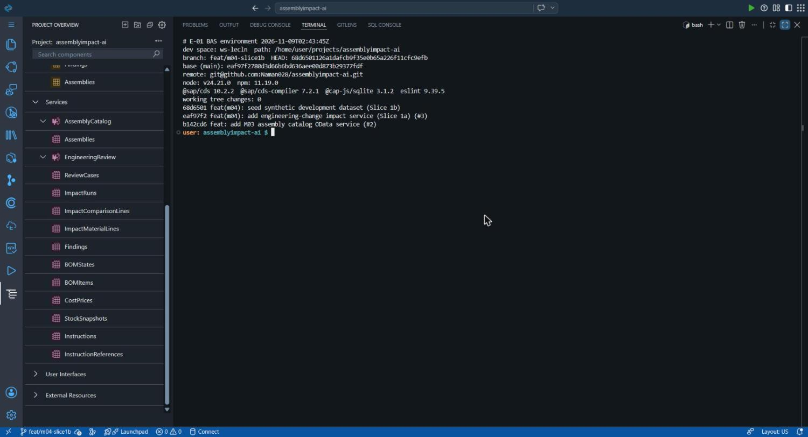
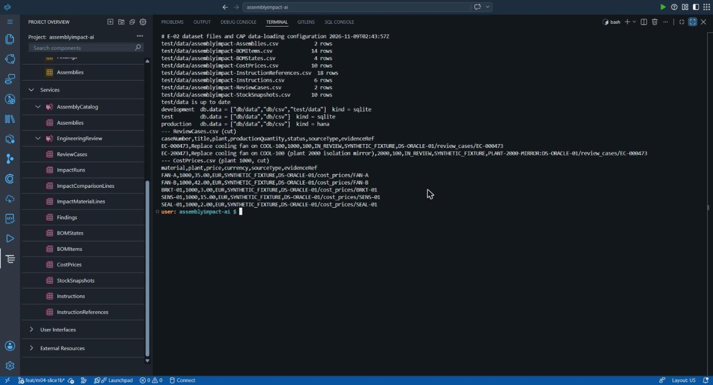
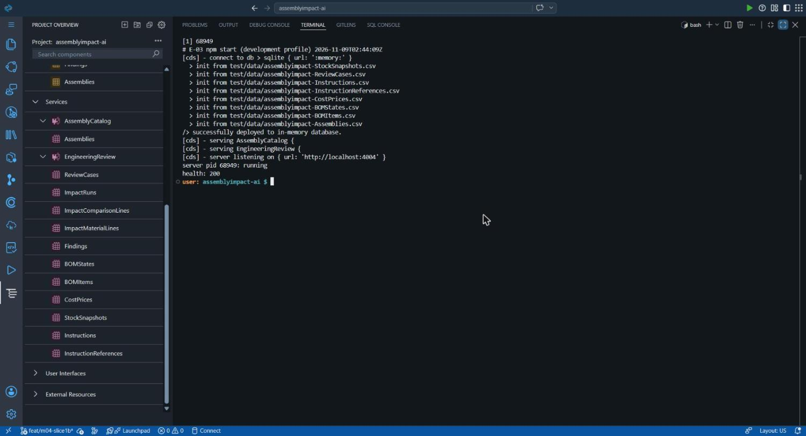
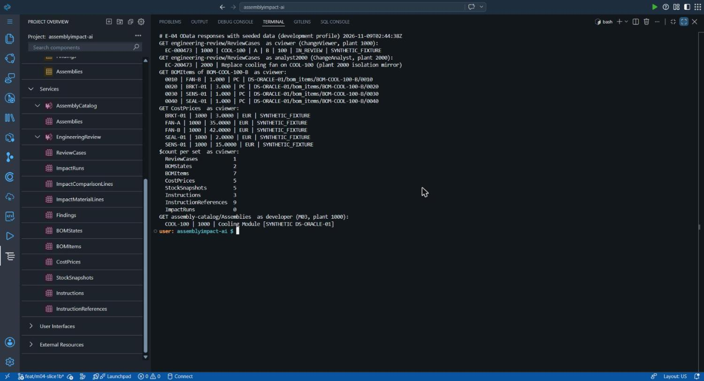
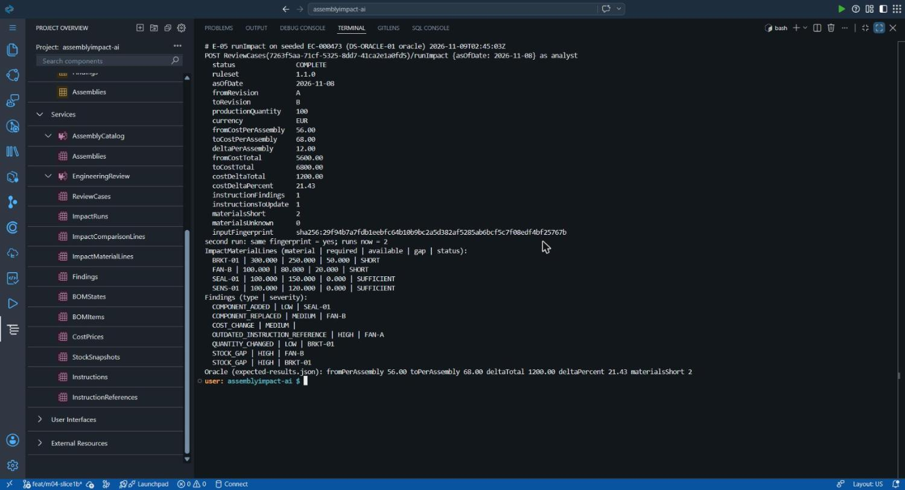
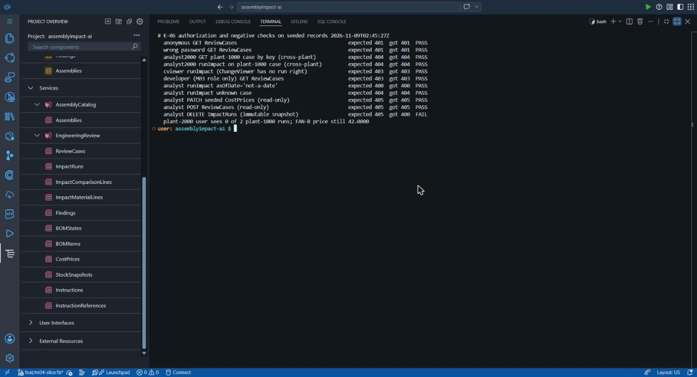
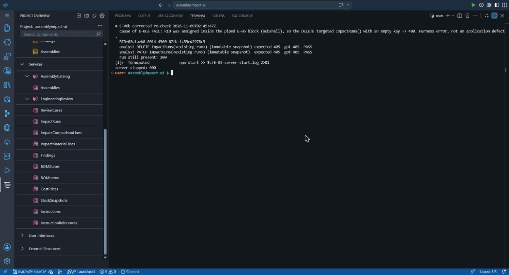
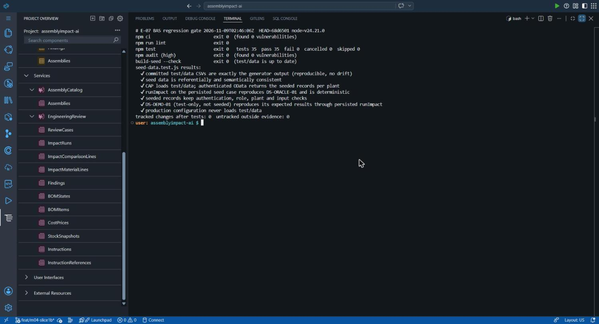

# AssemblyImpact AI — M04 Slice 1b Implementation, Testing & Evidence Report

Generated from `build_report.py`; PDF: `M04_Slice1b_Report.pdf`.

## 1. Executive summary

**Objective.** Complete a reproducible synthetic manufacturing dataset and make it available through the existing SAP CAP services (M04 Slice 1b), without starting P3 Project Accelerator generation or P4 UI work.

**Status.** Implemented and verified in SAP Business Application Studio (BAS). Implementation commit `68d6501126a1` on `feat/m04-slice1b`. GitHub Actions: not yet available when this report was generated. Draft pull request: not yet created. Not merged.

- CAP development seed SEED-M04-01 in `test/data`: COOL-100 / EC-000473 (DS-ORACLE-01, plant 1000) and a labelled plant-2000 mirror (EC-200473). 66 rows in 8 entities, all synthetic and traceable to versioned fixtures.
- Generator with deterministic keys and a drift test; the committed CSVs are byte-identical to generator output.
- Seed loads with `npm start` (development); excluded from the test profile by configuration and never resolved in production (verified).
- runImpact on the persisted seed reproduces the independent DS-ORACLE-01 oracle; DS-DEMO-01 is verified through a persisted run in tests only (Decision A).
- Plant isolation, roles, authentication, read-only and malformed-input behaviour re-verified on seeded records.
- BAS: npm ci, lint, 35/35 tests and npm audit (0 vulnerabilities) all exit 0.

**Remaining limitations.** No Fiori UI; no live S/4HANA data; no Joule; no BTP deployment, HANA persistence or xs-security role definitions; development credentials are public mock values. Synthetic data is not SAP data.

## 2. Starting state

| Item | Value |
| --- | --- |
| GitHub baseline | main = eaf97f2780d3 (M04 Slice 1a squash-merge, PR #3); CI passed (owner-reported, PR #3 CI run on ea53c4d verified earlier) |
| BAS environment | SAP BTP trial, dev space ws-lecln, /home/user/projects/assemblyimpact-ai, synchronized to main (fast-forward) |
| Runtime (BAS) | Node v24.21.0, npm 11.19.0, @sap/cds 10.2.2, @sap/cds-compiler 7.2.1, @cap-js/sqlite 3.1.2, eslint 9.39.5 |
| Architecture | CAP OData V4: AssemblyCatalog (M03) and EngineeringReview (M04 Slice 1a, read-only + runImpact action, ruleset 1.1.0) |
| Original problem | Services started empty: the synthetic fixtures were usable by tests only; the development profile had no EngineeringReview users; nothing guarded production against test data. |

## 3. Implementation record

| Unit | Files | What | Why / decision | Evidence |
| --- | --- | --- | --- | --- |
| U1 Seed builder | test/m04-seed.js | Builds CAP rows from test/fixtures/m04 for each seed scenario; name-based UUID keys; mirror logic with evidence-reference prefix; CSV serialiser. | Single source of truth; reproducibility (D-1b-2, D-1b-5, D-1b-7). | E-02, drift test |
| U2 Generator CLI | tools/m04/build-seed.mjs, tools/m04/README.md | Writes test/data/*.csv; --check exits 1 when out of date. | Regeneration without hand edits (D-1b-5). | E-02, E-07 |
| U3 Seed CSVs | test/data/assemblyimpact-*.csv (8), test/data/README.md | 66 synthetic rows with provenance; README documents origin and loading rules. | Requirement 2, 3, 5, 7 (D-1b-1, D-1b-3, D-1b-9). | E-02, E-03, E-04 |
| U4 Profile configuration | package.json | [test] requires.db.data = db/data, db/csv; development users analyst, cviewer, analyst2000; npm test includes the new suite. | Keep existing suites isolated; demonstrable dev profile (D-1b-4, D-1b-8). | E-02, E-04 |
| U5 Verification suite | test/seed-data.test.js | 7 tests: drift, integrity, CAP loading and per-plant OData, oracle via persisted runImpact, auth/plant/input negatives, DS-DEMO-01 persisted run, production exclusion. | Requirements 6-12; quality gates. | E-07 |
| U6 Documentation | readme.md | Slice 1b section, development accounts, evidence statement with AI-assistance disclosure. | Traceability and truthful AI records. | - |

**Technical explanation.** CAP 10.2.2 resolves seed folders from `cds.requires.db.data` (see `lib/dbs/cds-deploy.js` in the installed package). The installed defaults are `db/data, db/csv, test/data` for development and test, and `db/data, db/csv` for production (HANA). The project overrides only the test profile, so the existing M03 and Slice 1a suites keep inserting their own rows into an empty in-memory database, while `test/seed-data.test.js` opts in through `CDS_CONFIG`. Impact runs are never seeded; they are produced by `runImpact`, which needs the seeded `ReviewCases.version` compare-and-set token.

The full decision log (D-1b-1 to D-1b-9) is in `docs/evidence/m04-slice1b/decisions.md`.

## 4. Dataset specification

Dataset **SEED-M04-01** — fictional company NovaMotion Manufacturing. **Synthetic; not SAP S/4HANA data.** Source: `test/fixtures/m04/DS-ORACLE-01` (v1.0.0, reference date 2026-11-08). Values marked PROPOSED in the data contract still need owner confirmation.

| Entity (CSV) | Plant 1000 | Plant 2000 mirror | Total | Keys / relationships |
| --- | --- | --- | --- | --- |
| Assemblies | 1 | 1 | 2 | COOL-100 per plant; description carries [SYNTHETIC ...] |
| BOMStates | 2 | 2 | 4 | BOM-COOL-100-A (rev A, 2026-01-01..2026-11-30, RELEASED), -B (rev B, from 2026-12-01, PROPOSED, EC-000473) |
| BOMItems | 7 | 7 | 14 | A: FAN-A 1, BRKT-01 2, SENS-01 1; B: FAN-B 1, BRKT-01 3, SENS-01 1, SEAL-01 1 (PC) |
| CostPrices | 5 | 5 | 10 | EUR, price unit 1 PC, SYNTHETIC_STANDARD_PRICE, valid 2026-01-01..9999-12-31 |
| StockSnapshots | 5 | 5 | 10 | snapshot 2026-11-08T08:00:00Z; FAN-A 40, FAN-B 80, BRKT-01 250, SENS-01 120, SEAL-01 150 |
| Instructions | 3 | 3 | 6 | WI-COOL-100-ASM v2 (rev A), v3 (rev B), WI-COOL-100-TST v2 (all revisions) |
| InstructionReferences | 9 | 9 | 18 | step -> material/quantity per instruction version |
| ReviewCases | 1 | 1 | 2 | EC-000473 / EC-200473: A -> B, production quantity 100, IN_REVIEW |
| Total | 33 | 33 | 66 |  |

**Prices (EUR/PC):** FAN-A 35.00, FAN-B 42.00, BRKT-01 3.00, SENS-01 15.00, SEAL-01 2.00. **Expected result (oracle, ruleset 1.1.0, as of 2026-11-08):** cost per assembly 56.00 -> 68.00 (+12.00), total for 100 assemblies 5600.00 -> 6800.00 (+1200.00, +21.43 %); stock gaps BRKT-01 50 and FAN-B 20; comparison REPLACED / QUANTITY_CHANGED / UNCHANGED / ADDED; one outdated instruction reference (WI-COOL-100-TST step 0030 -> FAN-A); 7 findings (HIGH 3, MEDIUM 2, LOW 2).

**Provenance:** every row with a sourceType is SYNTHETIC_FIXTURE and carries an evidence reference to its fixture row; mirror references start with `PLANT-2000-MIRROR:`. **Not seeded:** PUMP-200 / DS-DEMO-01 (test-only, Decision A) and impact runs (always computed). **Limitations:** one scenario only; no historical revisions beyond A/B; no S/4HANA identifiers; data contract values marked PROPOSED await owner confirmation.

## 5. Testing and verification

| Command (BAS, E-07) | Exit | Observed |
| --- | --- | --- |
| npm ci | 0 | found 0 vulnerabilities |
| npm run lint | 0 | eslint srv test --max-warnings=0 |
| npm test | 0 | tests 35, pass 35, fail 0, cancelled 0, skipped 0 |
| npm audit --package-lock-only --audit-level=high | 0 | found 0 vulnerabilities |
| node tools/m04/build-seed.mjs --check | 0 | test/data is up to date |
| git status (after tests) | - | 0 tracked changes; no untracked files outside the evidence folder |

**New tests (test/seed-data.test.js), all passing locally (Node 24.22.2) and in BAS (Node 24.21.0):**

| Test | Expected | Observed |
| --- | --- | --- |
| CSVs equal generator output; generator deterministic | byte-identical | pass |
| Referential and semantic integrity | unique keys, FKs, plant/assembly agreement, A ends before B, priced and stocked materials, EUR, labels, no PUMP-200 | pass |
| CAP loads test/data; per-plant OData | counts 1/2/7/5/5/3/9 per plant; plant 2000 sees EC-200473 only; M03 shows labelled COOL-100 | pass |
| runImpact on persisted seed vs DS-ORACLE-01 | all oracle figures, lines and findings; same fingerprint on repeat | pass |
| Auth/plant/input negatives on seed | 401, 404 cross-plant, 403 viewer/wildcard/malformed/M03 role, 400 bad date, 405 writes | pass |
| DS-DEMO-01 via persisted runImpact (test-only) | DS-DEMO-01 expected results | pass |
| Production never loads test/data | production db.data and resources exclude test/data; development includes 8 files | pass |

**Failures and corrections.** (1) Mutation check: changing the seeded FAN-B price from 42.00 to 43.00 made the drift, oracle and price tests fail as intended; restored, all pass. (2) E-06a evidence harness reported 400 for DELETE ImpactRuns because the run ID variable was empty (subshell); re-run in E-06b returned 405 for DELETE and PATCH. No application code was changed for either.

**Live checks in BAS (development profile, E-03 to E-06b):** 13 HTTP checks plus the oracle comparison; all pass after the E-06b correction.

## 6. Screenshot evidence

Original, unedited screenshots of the BAS browser tab captured with Claude in Chrome. Times are UTC from the terminal clock. No secrets are visible (no credentials are printed; development passwords are public mock values).

**E-01 — BAS repository, branch and environment identification** (2026-11-09T02:43:45Z UTC)



Dev space ws-lecln, branch feat/m04-slice1b at 68d6501 on base eaf97f2; Node v24.21.0, @sap/cds 10.2.2, cds-compiler 7.2.1, @cap-js/sqlite 3.1.2; clean tree.

**E-02 — CAP development/test dataset files and data-loading configuration** (2026-11-09T02:43:57Z UTC)



Eight CSVs in test/data with row counts; drift check up to date; resolved db.data: development includes test/data, test and production do not.

**E-03 — Successful CAP server startup (npm start, development profile)** (2026-11-09T02:44:09Z UTC)



In-memory SQLite, all eight test/data CSVs loaded ("init from"), AssemblyCatalog and EngineeringReview served on :4004, health 200.

**E-04 — OData responses showing seeded engineering data** (2026-11-09T02:44:38Z UTC)



cviewer (plant 1000) sees EC-000473 only; analyst2000 (plant 2000) sees EC-200473 only; BOM B items, prices, $count per set (ImpactRuns 0 before any run); M03 Assemblies shows the labelled COOL-100.

**E-05 — Deterministic impact calculation for the approved oracle scenario** (2026-11-09T02:45:03Z UTC)



runImpact on persisted EC-000473: 56.00 -> 68.00 EUR per assembly, +1200.00 EUR total (21.43 %), 2 materials short, 7 findings; second run has the same fingerprint.

**E-06a — Authorization and negative tests (first pass)** (2026-11-09T02:45:27Z UTC)



10 of 11 checks PASS. The DELETE ImpactRuns check shows FAIL (400) because of a harness error (empty run ID); kept unedited as evidence.

**E-06b — Corrected re-check of the immutable-snapshot checks** (2026-11-09T02:45:47Z UTC)



With the real run ID: DELETE 405 and PATCH 405 on ImpactRuns, run still present (200); development server stopped.

**E-07 — Final BAS regression results** (2026-11-09T02:46:06Z UTC)



npm ci 0, lint 0, npm test 35/35 (0 fail), npm audit 0 vulnerabilities, build-seed --check up to date, no tracked changes after tests.

## 7. Security and quality

| Area | Result | Evidence |
| --- | --- | --- |
| Authentication | Anonymous and wrong password -> 401; production profile still requires JWT (existing test) | E-06a, tests |
| Role-based authorization | ChangeViewer cannot run (403); M03-only role has no M04 access (403); writes 405 | E-06a/b, tests |
| Plant isolation | Plant-2000 user sees only EC-200473 and 0 plant-1000 runs; cross-plant key and runImpact -> 404 | E-04, E-06a, tests |
| Malformed input | asOfDate "not-a-date" -> 400; unknown case -> 404; malformed/wildcard plant attributes -> 403 | E-06a, tests |
| Synthetic data containment | Production resolves only db/data and db/csv; automated test | E-02, tests |
| Dependencies | No new packages; package-lock.json unchanged; npm audit 0 vulnerabilities | E-07 |
| Secrets | Diff scan: no keys/tokens/private keys; only public mock passwords in profile config | review |

**Unresolved risks.** No xs-security.json / role templates (blocks BTP deployment, carried over from M03/Slice 1a); development mock passwords are public by design and must never be used in production; GitHub web squash-merges record "GitHub" as committer (owner rule: committer Naman Patel); the GitHub SSH key needs a passphrase or agent for non-interactive fetch/push.

**Review disclosure.** Code review and quality assessment were performed by one AI system (Claude, Anthropic). No human or SAP reviewer took part.

## 8. GitHub traceability

| Item | Value | Status |
| --- | --- | --- |
| Branch | feat/m04-slice1b (from main eaf97f2) | verified |
| Implementation commit | 68d6501126a1dafcb9f35e0b65a226f11cfc9efb — feat(m04): seed synthetic development dataset (Slice 1b); author and committer Naman Patel <108478447+Naman028@users.noreply.github.com>; no co-author trailer | verified (BAS, E-01) |
| Evidence commit | Adds docs/evidence/m04-slice1b (this report). Its SHA is recorded in the PR; a file cannot contain its own commit hash. | see PR |
| Changed files (implementation) | 15 files, +518 / -9: package.json, readme.md, test/data/* (9), test/m04-seed.js, test/seed-data.test.js, tools/m04/build-seed.mjs, tools/m04/README.md | verified |
| Pull request | not created | pending (created after push) |
| CI | GitHub Actions: not yet available when this report was generated | pending |
| main | unchanged at eaf97f2780d3 | verified unchanged before push |

## 9. Four-project relevance

| Project | What this milestone contributes | Not claimed |
| --- | --- | --- |
| P1 Joule Skill & Agent | A seeded, authorized OData backend a future skill could call (read cases, run impact). | No Joule access or skill exists. |
| P2 S/4HANA + GenAI | A clearly labelled synthetic baseline to compare against real S/4HANA data later; SourceType S4_IMPORT reserved. | No S/4HANA connection; synthetic data cannot replace it. |
| P3 AI-assisted Fiori (Project Accelerator) | Real persisted records for the planned Case Worklist to display. | No Project Accelerator generation was run. |
| P4 Fiori on BTP | Backend data and verified impact engine for the investigation app. | No UI and no BTP deployment. |

## 10. Remaining work

- Owner review of D-1b-1 to D-1b-9 and confirmation of PROPOSED fixture values.
- Merge of the draft PR after review (separate approval).
- Next milestone (proposed): P3 Case Worklist via Project Accelerator in an isolated sandbox. Acceptance criteria: generation in pa-sandbox only; generated files identified; worklist lists the seeded review case(s) from EngineeringReview with plant isolation intact; every manual correction documented; existing 35 tests still pass.
- BTP readiness: xs-security.json with ChangeViewer/ChangeAnalyst role templates and plants attribute, HANA persistence, approuter/IdP, deployment approval.
- P2 blocker: authorized S/4HANA access. P1 blocker: Joule Studio entitlement.
- Tooling: SSH agent or key configuration in BAS for non-interactive Git; ESLint 9 follow-up from M03.

## Appendix A — Traceability matrix

| Req. | Requirement (milestone brief) | Implementation | Test / evidence |
| --- | --- | --- | --- |
| 1 | Inspect model, services, fixtures, config | Inspection (section 2) | E-01, E-02 |
| 2-3 | Consistent dataset reusing DS-ORACLE-01 / DS-DEMO-01 | U1, U3; DS-DEMO-01 test-only (D-1b-1) | integrity + DS-DEMO-01 tests |
| 4 | Preserve DS-NEG-01 coverage | Unchanged calculator tests | E-07 (35/35) |
| 5-6 | test/data; verify data loading vs installed CAP | U3, U4 (D-1b-3, D-1b-4) | E-02, production test |
| 7 | Mutually consistent keys, dates, units, currency | U1 | integrity test |
| 8-9 | Load into CAP; OData returns seeded records | U3, U4 | E-03, E-04, loading test |
| 10 | Deterministic runImpact from persisted data | existing engine on seed | E-05, oracle test |
| 11 | M03 works; plant authorization preserved | mirror (D-1b-2) | E-04, E-06a/b, tests |
| 12 | Production free of synthetic records | D-1b-3 | E-02, production test |

## Appendix B — Evidence manifest (screenshots)

| ID | File | Captured (UTC) | SHA-256 |
| --- | --- | --- | --- |
| E-01 | E-01_bas-environment.jpg | 2026-11-09T02:43:45Z | 4e95305d38046deb4a18b625d3ec830ad732913c538656c5754ffadeae48fe7f |
| E-02 | E-02_dataset-files-and-config.jpg | 2026-11-09T02:43:57Z | f5cd022e8b1a0e47fca03d70e5d9ead799628f647ec57aa47246a56f78a92652 |
| E-03 | E-03_cap-server-startup-seed-loaded.jpg | 2026-11-09T02:44:09Z | b58e58ff6bec997cd8589e2dcbd054243c12d36732fa0ad791bc37624726d0c5 |
| E-04 | E-04_odata-seeded-records.jpg | 2026-11-09T02:44:38Z | 5395d4a6aec34b8416fd5844b26bcbaaf1062319430b7ecedaee7268d5151b11 |
| E-05 | E-05_runimpact-oracle-result.jpg | 2026-11-09T02:45:03Z | 4a05a85d639d1818c51eb02f998b9dc44a92a673b7330581b830df665e74ef75 |
| E-06a | E-06a_authorization-negative-checks.jpg | 2026-11-09T02:45:27Z | 3994af137d1f1276607ebb518db88afc1763f4210e1ea331b5e1b6c67332595c |
| E-06b | E-06b_authorization-recheck.jpg | 2026-11-09T02:45:47Z | 77a55457a49d236fb58d4da7e40b69316f8d2e51fb79e39581dbe4ef44423ce3 |
| E-07 | E-07_bas-regression-gate.jpg | 2026-11-09T02:46:06Z | 82795b6e0126e254e1d9222502e314c47ed2dc62c8ca72710d6f5549691307a7 |

Logs captured in BAS (docs/evidence/m04-slice1b/logs, E-01 to E-07) are hashed in evidence-manifest.json, generated in BAS when the evidence was committed.

## Appendix C — Key log excerpt (BAS, E-07)

```
# E-07 BAS regression gate 2026-11-09T02:46:06Z  HEAD=68d6501 node=v24.21.0
npm ci                         exit 0  (found 0 vulnerabilities)
npm run lint                   exit 0
npm test                       exit 0   tests 35  pass 35  fail 0  cancelled 0  skipped 0
npm audit (high)               exit 0  (found 0 vulnerabilities)
build-seed --check             exit 0  (test/data is up to date)
tracked changes after tests: 0  untracked outside evidence: 0
```

## Appendix D — References

- SAP CAP (capire): Providing initial data — https://cap.cloud.sap/docs/guides/databases#providing-initial-data
- Installed source used for verification: node_modules/@sap/cds/lib/dbs/cds-deploy.js (deploy.resources), @sap/cds 10.2.2
- Project artifacts: docs/m04/M04_Data_Contract.md, test/fixtures/m04 (DS-ORACLE-01 v1.0.0, DS-DEMO-01 v1.0.1, DS-NEG-01 v1.1.0), M04 v1.2 decisions (Decision A)
- AI assistance: implementation, tests, evidence capture and this report were produced by Claude (Anthropic, model Claude Opus 5.5) under owner authorization; student review pending.
