# AssemblyImpact AI — P3 Engineering Change Case Worklist: Implementation, Testing & Evidence Report

Generated from `report-source/build_report.py`; PDF: `P3_Case_Worklist_Report.pdf`.

## 1. Executive summary

**Objective.** Begin P3: generate a Fiori elements Case Worklist with SAP Project Accelerator in an isolated sandbox, run the generated UI, and connect a corrected version to the existing read-only EngineeringReview OData V4 service.

**Status.** Implemented and verified in a running browser session in SAP Business Application Studio (BAS). Branch `feat/p3-case-worklist` (3 commits on main a0068c6). GitHub Actions: not yet available when this report was generated. Draft pull request: not yet created. Not merged, not deployed.

- Project Accelerator ran in the separate sandbox `pa-sandbox/case-worklist`; its original 44 files are preserved unchanged (sandbox commit 9910c02, copy in `generated/`).
- The generated app was run in the browser with its own mock data (P3-08, P3-09). It showed invented values and draft editing, so only its page structure was reused.
- The implemented app `app/case-worklist` shows Review Cases -> Review Case -> Impact Run -> Finding from EngineeringReview, with the Run Impact action.
- Browser checks: plant isolation, 403 for viewers on Run Impact, analyst run reproducing the oracle (+1,200.00 EUR, 2 short, 7 findings), cross-plant deep link 404.
- Three defects found only in the browser were fixed: UI5 1.120 startup error, zero-height app container, unsorted section tables.
- npm test 40/40 and lint pass locally and in BAS; no new dependencies.

**Not claimed.** The Project Accelerator Page Map (P3-05) is a design-time view, not a working UI; the working UI is the browser-rendered application in P3-08 to P3-20. No BTP deployment, no S/4HANA data, no Joule, no P4 work. All records are synthetic.

## 2. Starting state and inputs

| Item | Value |
| --- | --- |
| GitHub baseline | main = a0068c6050ca (M04 Slice 1b, PR #4). BAS fast-forwarded; 35/35 tests (P3-01). |
| Backend | CAP OData V4 EngineeringReview: ReviewCases, ImpactRuns, Findings, ImpactMaterialLines, ImpactComparisonLines; read-only plus bound action runImpact (ChangeAnalyst, plant-restricted). |
| Seed data | SEED-M04-01 (synthetic): EC-000473 / COOL-100 plant 1000 and mirror EC-200473 plant 2000. No impact runs are seeded. |
| Design input | Approved layout mockup (illustrative values) and requirements AssemblyImpact_Case_Worklist_requirements.md (sha256 021aa8e1…). |
| Runtime (BAS) | Node v24.21.0, @sap/cds 10.2.2, cds-compiler 7.2.1, @cap-js/sqlite 3.1.2, @sap/cds-fiori 2.3.0; SAPUI5 1.149.0 (CDN). |

## 3. Project Accelerator generation (sandbox)

Project Accelerator (SAP Fiori tools, CAP Accelerator flow) was given the requirements text and the layout image (P3-02 to P3-04). The output was committed in the sandbox as 9910c02 and archived (`pa-original-output.tgz`, sha256 e3af883acbae…). The original files are copied unchanged to `docs/evidence/p3-case-worklist/generated/`; the archive itself is not committed.

| Generated part | Content | Used? |
| --- | --- | --- |
| Data model | Own namespace assemblyImpactCaseWorklist: ReviewCases, Assemblies, Findings, MaterialImpacts, DecisionHistories + 6 code lists | No (D-P3-2) |
| Service | assemblyImpactCaseWorklistSrv at /odata/v4/assembly-impact-case-worklist-srv/, @odata.draft.enabled | No |
| Sample data | CSV rows invented by the generator (10 cases, findings, materials) | No |
| Fiori app | List Report -> Object Page -> Findings Object Page; minUI5Version 1.149.0 | Page structure only |
| Metadata | .fiori-ai: log.txt, model.json, user-input.txt, userImage.png | Evidence only |

## 4. Generated UI preview and design comparison

The generated application was started in the sandbox and opened in the browser (P3-08, P3-09). It renders, but with the generator's own invented records and draft editing (Create, Edit, Delete, Editing Status), which conflicts with the read-only, role- and plant-checked EngineeringReview service.

| Mockup / requirement | Project Accelerator output | Implemented | Reason |
| --- | --- | --- | --- |
| Filters: Assembly, Plant, Revision, Status, Source | Filters on generated entity + Editing Status | assemblyCode, plant, toRevision, status, sourceType | same intent on existing service |
| Columns up to Review Status | Columns on generated entity | 9 columns; findings / short / cost delta from latestRun | figures come from immutable runImpact snapshots |
| Status colours | Code-list criticality | $edmJson If/Eq criticality on status | no new backend field |
| Create Change, Export | Create/Delete (draft) | Not implemented | read-only service (D-P3-5) |
| Case: General information | Object Page section | FieldGroup General + Latest Impact | - |
| Findings tab on the case | /ReviewCases/Findings | Impact Run page -> Findings -> Finding page | findings stored per run (D-P3-3) |
| Material Impact tab | MaterialImpacts table | Impact Run page: Material Impact + BOM Comparison | per run |
| Decision History tab | DecisionHistories entity | Not shown | no backend entity yet |
| Run impact | Not generated | runImpact action on list and case | server-enforced (D-P3-4) |
| Draft editing | @odata.draft.enabled | None | service read-only by design |

## 5. Implementation record

| Unit | Files | What | Decision |
| --- | --- | --- | --- |
| U1 App descriptor | app/case-worklist/webapp/manifest.json, Component.js, index.html, i18n | dataSource /odata/v4/engineering-review/; routes ReviewCasesList, ReviewCasesObjectPage, ImpactRunsObjectPage, FindingsObjectPage; no draft; UI5 1.149.0 bootstrap. | D-P3-2, D-P3-3, D-P3-6 |
| U2 Annotations | app/case-worklist/annotations.cds | SelectionFields, LineItem with criticality and runImpact, HeaderInfo, FieldGroups, Facets, PresentationVariants on EngineeringReview entities. | D-P3-4, D-P3-7 |
| U3 Tests | test/case-worklist-app.test.js, package.json | 5 tests: manifest-model consistency, annotation contract, static serving, list/action authorization, navigation paths and plant isolation. | quality gate |
| U4 Documentation | app/case-worklist/README.md, readme.md | Origin, read-only scope, how to run with development users; synthetic-data notice. | traceability |

| Commit | Message |
| --- | --- |
| 77730307a1ab | feat(p3): add Engineering Change Case Worklist Fiori elements app |
| af43aafe863e | fix(p3): correct standalone UI rendering found in BAS preview |
| 377e46aa5b71 | fix(p3): apply table sort orders on Object Page sections |

All three commits: author and committer Naman Patel &lt;108478447+Naman028@users.noreply.github.com&gt;, no co-author trailer. The decision log is in `decisions.md`.

## 6. Corrections found in the running UI

| # | Observed in the browser | Cause | Fix | Evidence |
| --- | --- | --- | --- | --- |
| 1 | Blank page; console: storeInnerAppStateAsync is not a function | UI5 1.120.0 too old for the generated app pattern | Bootstrap SAPUI5 1.149.0 (af43aaf) | P3-10 onward |
| 2 | Still blank, no error | Component container had height 0 | Full height for #container-uiarea (af43aaf) | P3-10 onward |
| 3 | Material Impact and BOM rows unsorted | Section facets targeted @UI.LineItem, so the PresentationVariant added in af43aaf was ignored | Facets target nav/@UI.PresentationVariant; test forbids LineItem facet targets (377e46a) | P3-18 -> P3-19, P3-20 |

**Note on defect 3.** The browser had cached the older $metadata, so screenshots P3-14/P3-15 (taken after af43aaf) show the unsorted state as well. After forcing a metadata reload, the table bindings were checked in the page: findings sorted by [type, material], material lines by [material], comparison lines by [itemNo]. Commit af43aaf's message overstated its effect on sorting; 377e46a is the effective fix.

**Other observation.** One cold deep-link load right after switching development users showed a transient "Not Found" dialog; it did not recur on reload or in-app navigation. Logged as an open observation.

## 7. Testing and verification

| Command | Local | BAS |
| --- | --- | --- |
| npm test | tests 40, pass 40, fail 0 | tests 40, pass 40, fail 0 (after 377e46a) |
| npm run lint (eslint srv test --max-warnings=0) | exit 0 | exit 0 |
| Dependencies | package-lock.json unchanged | - |

| New test (test/case-worklist-app.test.js) | Checks | Result |
| --- | --- | --- |
| manifest targets EngineeringReview | dataSource, entity sets and navigation paths resolve against the CDS model; no draft | pass |
| annotation contract | exact columns and filters, facets, criticality, sort orders, no LineItem facet targets, $metadata carries UI annotations | pass |
| static serving | index.html, manifest, Component, i18n served; full-height container; UI5 1.149.0 bootstrap | pass |
| list and action | plant-1000 user sees 1 case, plant-2000 user only EC-200473; runImpact 200 analyst / 403 viewer / 404 other plant; columns 1 / 2 / 1200 | pass |
| navigation paths | case -> runs -> 7 findings / SHORT BRKT-01 50, FAN-B 20; cross-plant paths 404 or empty; anonymous 401 | pass |

| Browser check (BAS preview, development profile) | Expected | Observed | Evidence |
| --- | --- | --- | --- |
| Viewer opens worklist | 1 case, no impact figures yet | as expected | P3-10 |
| Viewer presses Run Impact | 403 message | 403 Forbidden shown | P3-11 |
| Analyst runs impact 2026-11-08 | 1 / 2 / 1,200.00 | 1 / 2 / 1,200.00 | P3-12 |
| Case and run pages | 56.00 -> 68.00, 21.43 %, 7 findings, 2 SHORT | as expected | P3-13 to P3-15 |
| Plant-2000 user | only EC-200473 | as expected | P3-16 |
| Cross-plant deep link | Not Found | Not Found | P3-17 |
| Section sorting | material / item / type order | unsorted before, sorted after 377e46a | P3-18 to P3-20 |

## 8. Screenshot evidence

Original, unedited captures of the browser in the BAS session, taken with Claude in Chrome. Times are UTC. No secrets are visible; development passwords are public mock values and are not shown.

**P3-01 — BAS synchronized to main and baseline regression** (2026-11-09T03:30:20Z UTC)

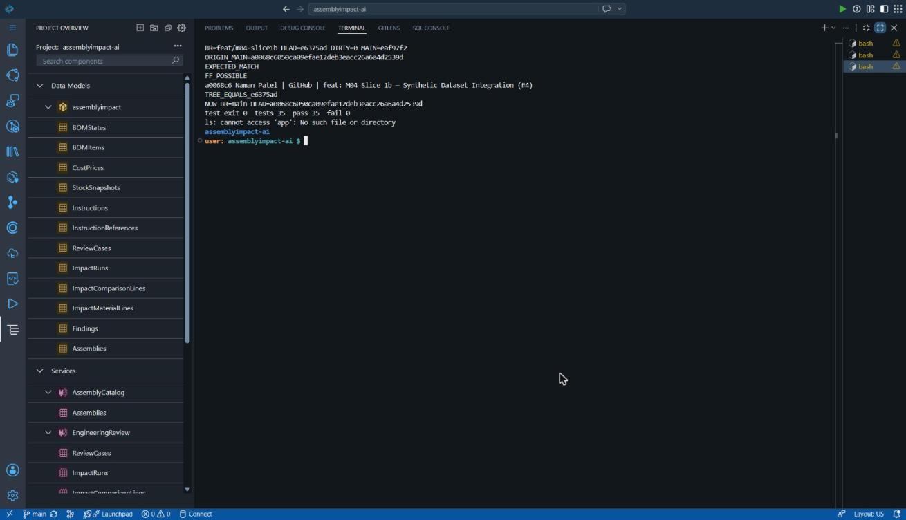

Repository in BAS fast-forwarded to main a0068c6 (M04 Slice 1b merge); baseline npm test 35/35 and lint pass before any P3 work.

**P3-02 — Project Accelerator input in the separate sandbox** (2026-11-09T03:33:25Z UTC)

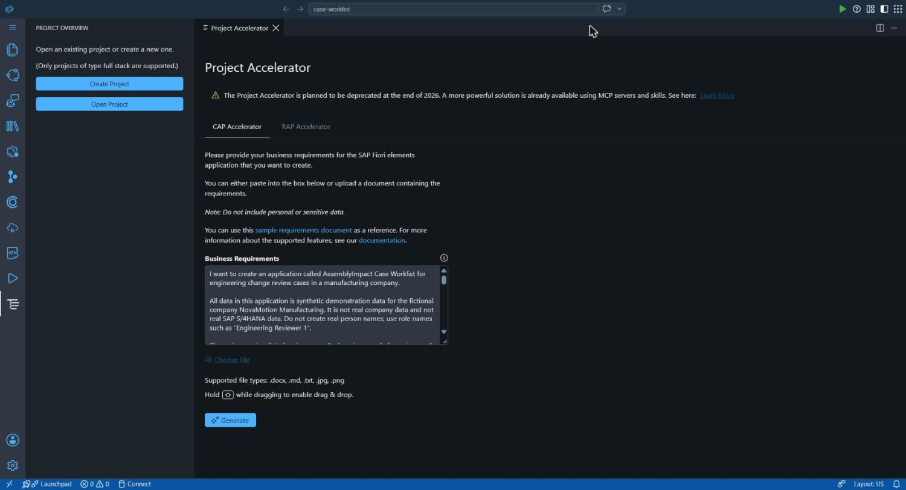

Project Accelerator opened in pa-sandbox/case-worklist with the requirements document and the approved layout image as input. Not the AssemblyImpact repository.

**P3-03 — Project Accelerator generation running** (2026-11-09T03:33:41Z UTC)

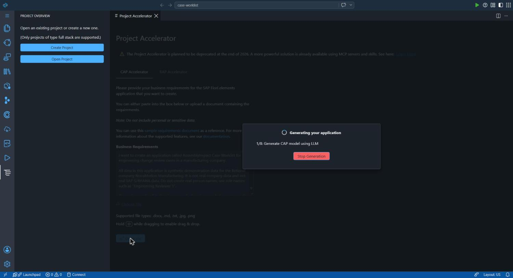

First generation step of the CAP Accelerator flow.

**P3-04 — Generation completed** (2026-11-09T03:35:29Z UTC)

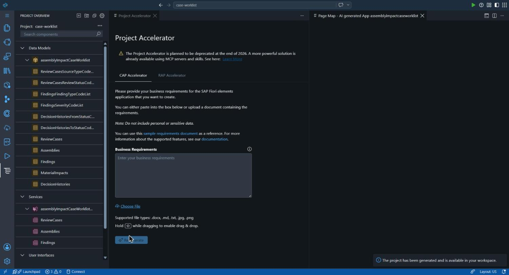

Project Accelerator reports the generated application assemblyImpactCaseWorklist.

**P3-05 — Generated Page Map (design-time view, not a running UI)** (2026-11-09T03:35:29Z UTC)

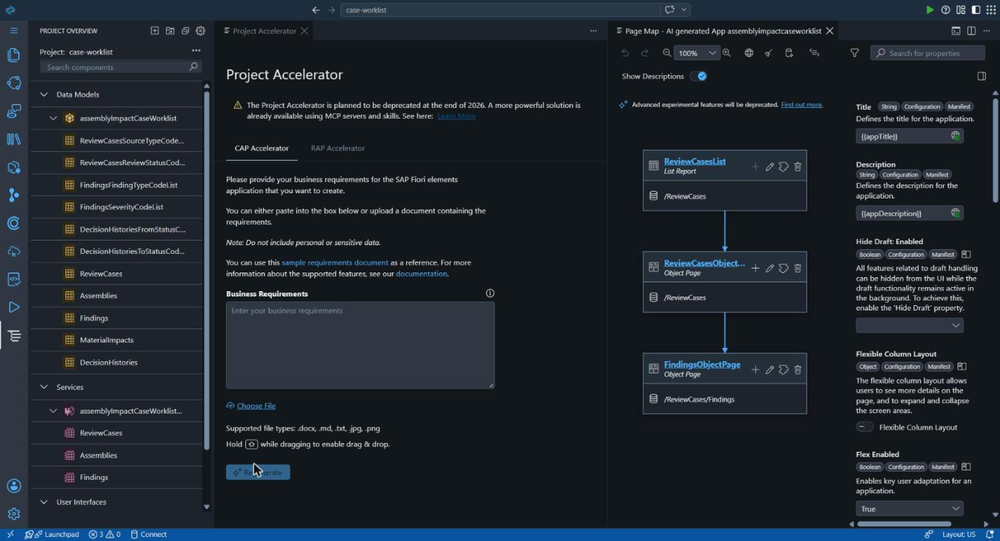

Page Map of the generated app: ReviewCases List Report -> ReviewCases Object Page -> Findings Object Page. A configuration view only; the running UI is shown in P3-08/P3-09.

**P3-06 — Generated files** (2026-11-09T03:35:54Z UTC)

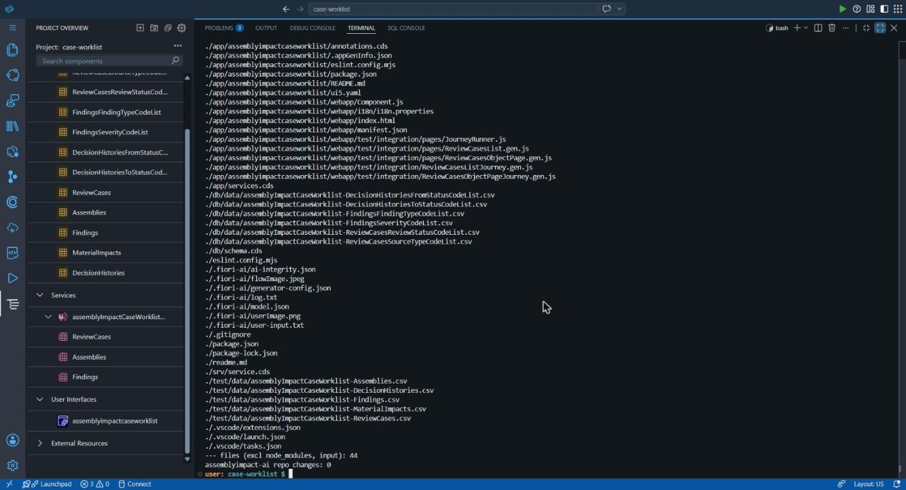

44 generated files: own CDS namespace, draft-enabled service, code lists, sample CSV data and a Fiori elements app.

**P3-07 — Sandbox baseline commit and generated draft service** (2026-11-09T03:36:27Z UTC)

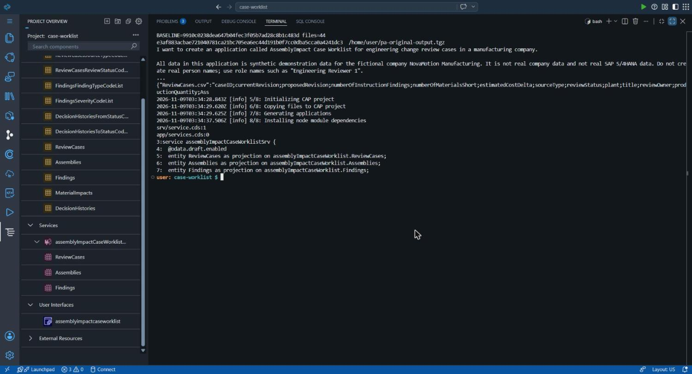

Original output committed in the sandbox as 9910c02 and archived (sha256 e3af883a…); generated service assemblyImpactCaseWorklistSrv is @odata.draft.enabled.

**P3-08 — Generated UI running with its own mock data — List Report** (2026-11-09T08:26:39Z UTC)

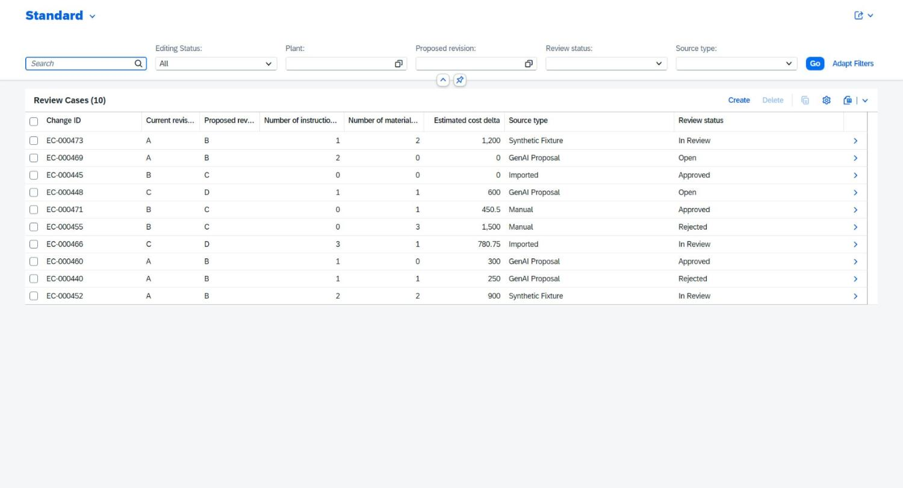

Browser-rendered generated app (sandbox cds watch). Shows 10 review cases invented by the generator, an Editing Status filter and Create/Delete buttons from draft handling. Not AssemblyImpact data.

**P3-09 — Generated UI running with its own mock data — Object Page** (2026-11-09T08:27:00Z UTC)

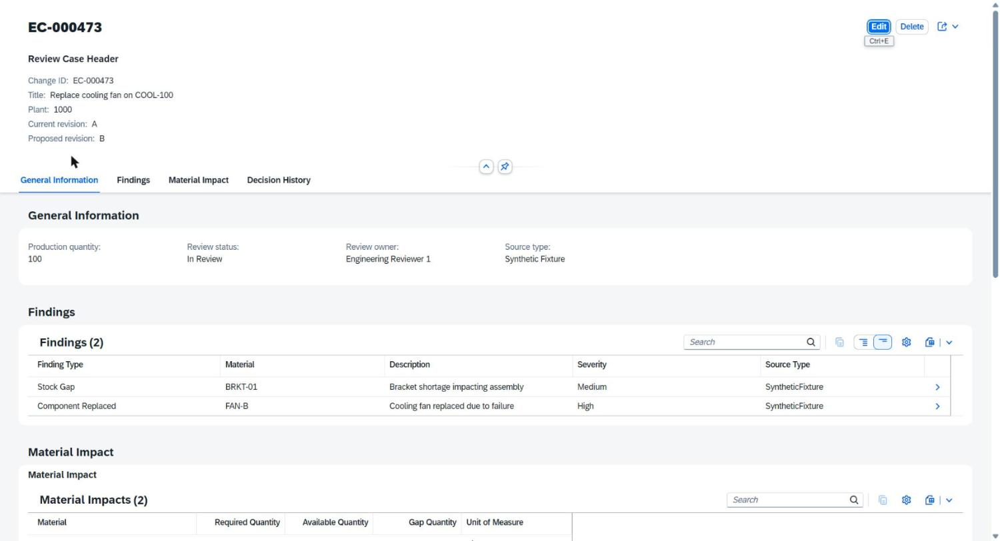

Generated Object Page with Edit/Delete and invented findings for EC-000473. Values do not match the backend oracle; this is why the generated data and service were not imported.

**P3-10 — Implemented worklist on EngineeringReview — viewer (plant 1000)** (2026-11-09T08:30:45Z UTC)

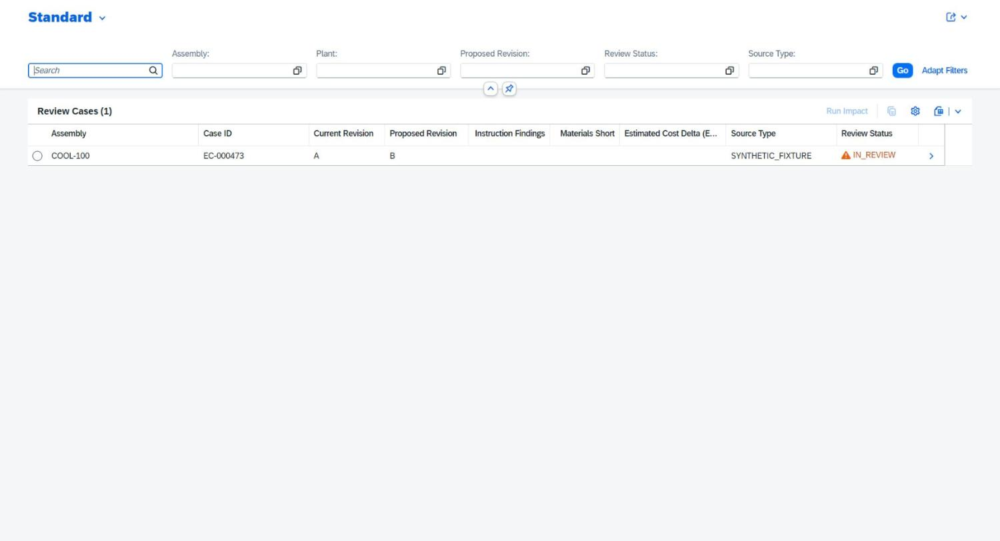

User cviewer sees one case, EC-000473 / COOL-100, IN_REVIEW. Impact columns are empty because no impact run exists yet.

**P3-11 — Run Impact refused for a viewer** (2026-11-09T08:31:10Z UTC)

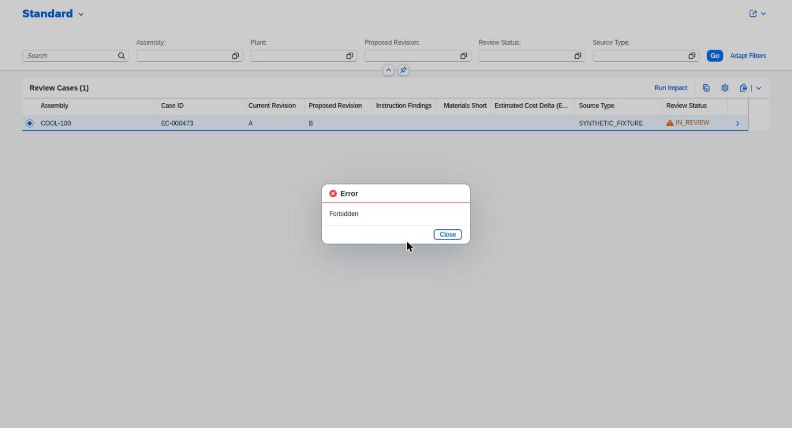

cviewer presses Run Impact; the server returns 403 Forbidden and the app shows the message. Authorization is enforced by the service.

**P3-12 — Run Impact by an analyst fills the worklist** (2026-11-09T08:31:44Z UTC)

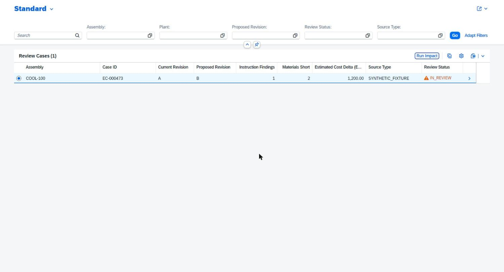

User analyst runs the impact for 2026-11-08: instruction findings 1, materials short 2, estimated cost delta 1,200.00 EUR (oracle values).

**P3-13 — Review Case Object Page** (2026-11-09T08:31:58Z UTC)

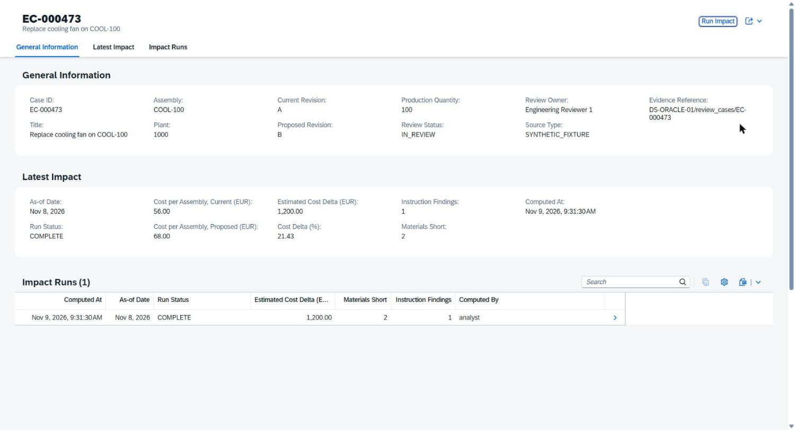

General section and Latest Impact (56.00 -> 68.00 EUR per assembly, +1,200.00 EUR, 21.43 %) and the list of impact runs.

**P3-14 — Impact Run page — findings** (2026-11-09T08:32:13Z UTC)

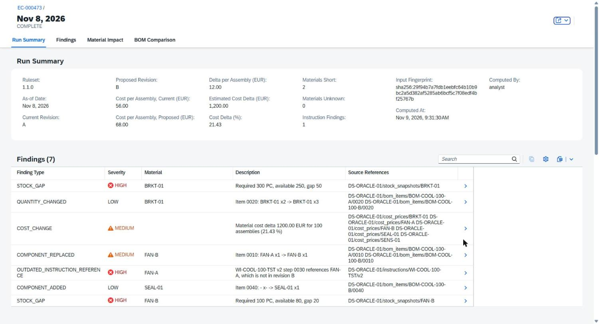

7 findings with severity criticality and evidence references. Captured before the sort-order fix (rows in backend order).

**P3-15 — Impact Run page — material impact and BOM comparison** (2026-11-09T08:32:30Z UTC)

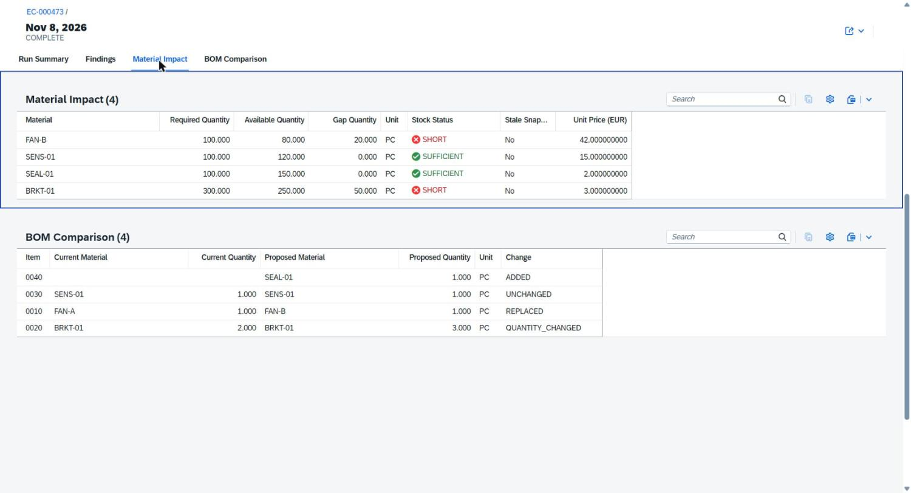

FAN-B gap 20 and BRKT-01 gap 50 marked SHORT; BOM comparison REPLACED / QUANTITY_CHANGED / UNCHANGED / ADDED. Captured before the sort-order fix.

**P3-16 — Plant isolation in the UI** (2026-11-09T08:32:47Z UTC)

User analyst2000 (plant 2000) sees only the labelled mirror case EC-200473.

**P3-17 — Cross-plant deep link refused** (2026-11-09T08:33:15Z UTC)

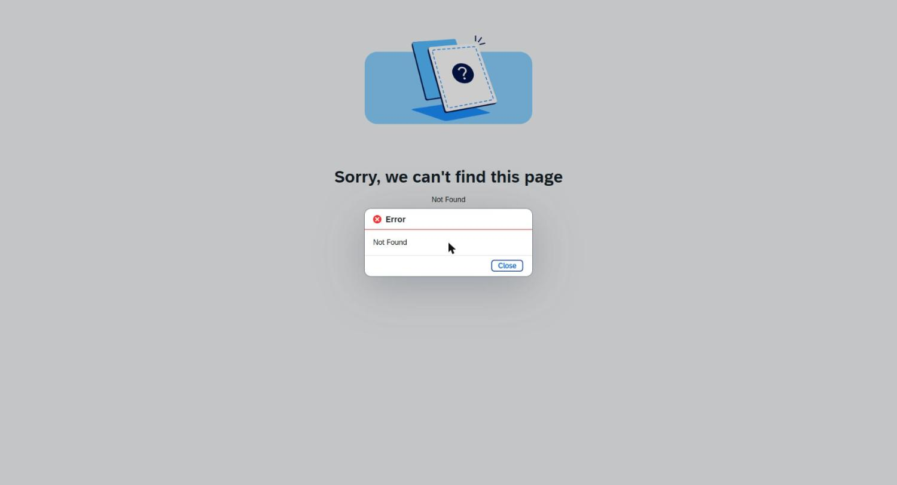

analyst2000 opens the plant-1000 case URL directly; the service answers 404 and the app shows Not Found.

**P3-18 — Defect found in the browser: section tables not sorted** (2026-11-09T08:37:25Z UTC)

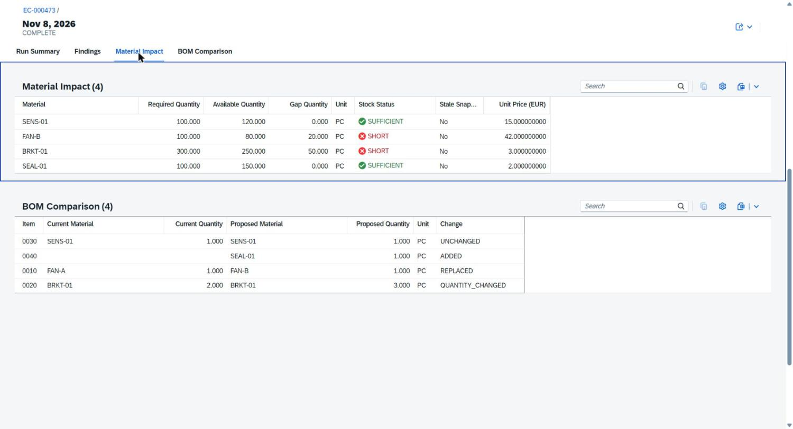

After commit af43aaf the Material Impact and BOM Comparison rows were still in insertion order (SENS-01 first, item 0030 first).

**P3-19 — After fix 377e46a: material and BOM tables sorted** (2026-11-09T08:42:01Z UTC)

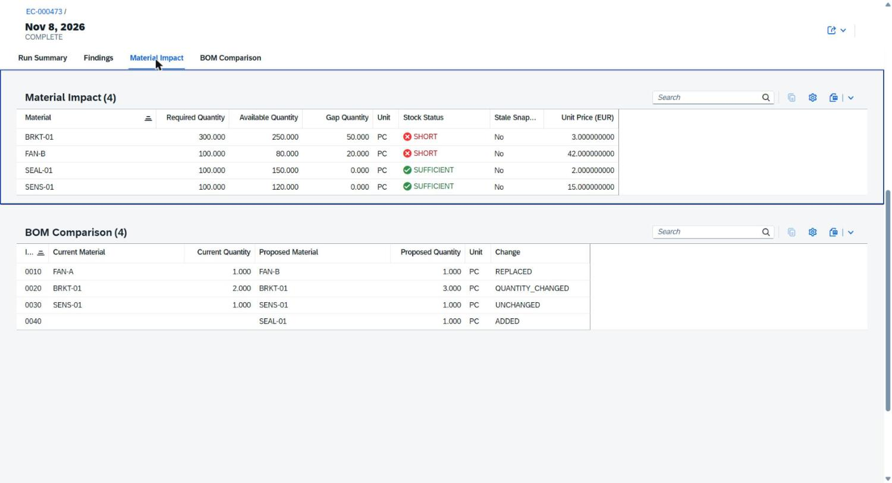

Material Impact sorted by material (BRKT-01, FAN-B, SEAL-01, SENS-01) and BOM Comparison by item (0010-0040); sort indicators shown in the column headers.

**P3-20 — After fix 377e46a: findings sorted by type and material** (2026-11-09T08:42:07Z UTC)

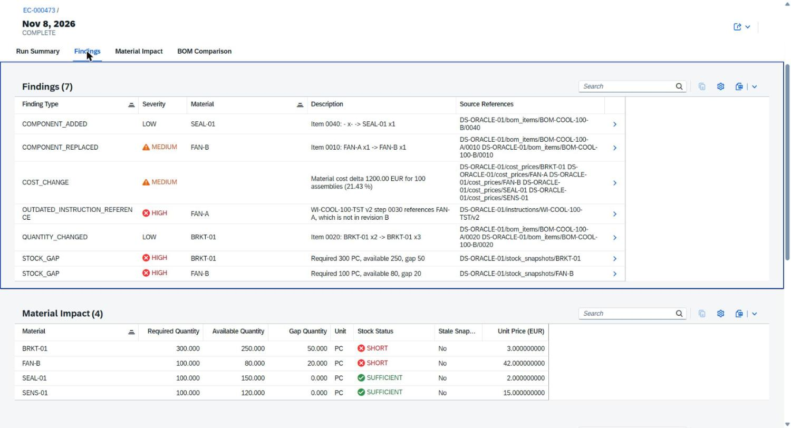

Findings sorted by finding type, then material; severity is shown with criticality icons.

## 9. Security review

| Area | Result | Evidence |
| --- | --- | --- |
| Authorization stays in the service | The UI adds no access logic; runImpact 403 for viewers and 404 across plants come from the backend | P3-11, P3-17, tests |
| Plant isolation | List, deep links and navigation paths respect the plant attribute | P3-16, P3-17, tests |
| Authentication | Anonymous OData request 401; the static app files are public but contain no data or secrets | tests |
| No write surface | No draft, create, update or delete; only the existing bound action | annotation test (no Draft) |
| Generated code | Generated service, data and draft handling not imported; sandbox kept separate | D-P3-1, D-P3-2 |
| External resources | SAPUI5 loaded from sapui5.hana.ondemand.com 1.149.0 (SAP CDN); no other third-party script | index.html |
| Dependencies / secrets | No new packages; diff contains no keys or tokens | review |

**Unresolved risks.** No xs-security.json or role templates (blocks BTP deployment); the Run Impact button is visible to viewers (server refuses); development mock passwords are public by design; the CDN dependency needs a CSP/approuter decision before deployment.

**Review disclosure.** Code review, security review and quality assessment were performed by one AI system (Claude, Anthropic). No human or SAP reviewer took part.

## 10. Limitations

- Unit price shows 9 decimals (backend Decimal scale); cosmetic, not fixed.
- Decision History, Create Change and Export from the mockup are not implemented (no backend support yet).
- Findings are not ordered by severity rank (string field); criticality icons mark severity.
- Run Impact uses a free date parameter dialog; no value help.
- Preview only in BAS with mocked authentication; no BTP deployment, approuter or launchpad tile.
- All data synthetic (NovaMotion Manufacturing); no S/4HANA connection; no Joule.

## 11. GitHub traceability

| Item | Value | Status |
| --- | --- | --- |
| Branch | feat/p3-case-worklist (from main a0068c6) | verified |
| Code commits | 77730307a1ab; af43aafe863e; 377e46aa5b71 (head 377e46aa5b71) | verified in BAS (same hashes) |
| Changed files (code) | 10 files: app/case-worklist (6), test/case-worklist-app.test.js, package.json, readme.md | verified |
| Evidence commit | docs(p3): add Case Worklist evidence (this folder); a file cannot contain its own commit hash | see PR |
| Pull request | not created | pending |
| CI | GitHub Actions: not yet available when this report was generated | pending |
| main | unchanged at a0068c6050ca | verified before push |

## 12. Four-project relevance and next steps

| Project | Contribution | Not claimed |
| --- | --- | --- |
| P1 Joule | Same authorized service a skill could call. | No Joule skill. |
| P2 S/4HANA + GenAI | UI ready to show S4_IMPORT cases later. | No S/4HANA data. |
| P3 Project Accelerator | Generated, run, compared and adapted; evidence of every correction. | Page Map is not a UI. |
| P4 custom investigation UI | None (kept separate). | Not started. |

- Owner review of D-P3-1 to D-P3-8 and of this PR; merge only with separate approval.
- Approval-workflow slice: decision history entity and actions, then the Decision History section.
- BTP readiness: xs-security.json, approuter, CSP for the UI5 CDN, HANA; deployment needs separate authorization.

## Appendix A — Evidence manifest (screenshots)

| ID | File | Captured (UTC) | SHA-256 |
| --- | --- | --- | --- |
| P3-01 | P3-01_bas-synced-main-regression.jpg | 2026-11-09T03:30:20Z | c164cf555a7a44f24fc90e0a4c9c5884a2bb5d28db129ab4be4141d024969d9f |
| P3-02 | P3-02_pa-input-requirements-loaded.jpg | 2026-11-09T03:33:25Z | eb762e28071947c4b6f41314c951fdbbb8acb604db3834cd0ffa467405ca5357 |
| P3-03 | P3-03_pa-generation-step1.jpg | 2026-11-09T03:33:41Z | a419db4e584d288f37358e0c4e34b2a8665473d3e6017908d96da3c73423ad4a |
| P3-04 | P3-04_pa-generation-complete.jpg | 2026-11-09T03:35:29Z | 765742603311cfceb07aef8ce3310a78442bdb4dc5b11c3b9b74ca83f084150b |
| P3-05 | P3-05_pa-page-map.jpg | 2026-11-09T03:35:29Z | f40b009d556e9fd3f6cab163483ac08ebc910fff619ea445146f13131f4002b6 |
| P3-06 | P3-06_pa-generated-files.jpg | 2026-11-09T03:35:54Z | af9b66a143dab755f236f7a27f2d4bf6a28c344c38aac971fd22f217c64f46dd |
| P3-07 | P3-07_pa-baseline-and-draft-service.jpg | 2026-11-09T03:36:27Z | 021252bc97ca329356c5d29e0e1eaa87337c3d39d5a5adf5bb615c1028de887c |
| P3-08 | P3-08_generated-ui-list-report.jpg | 2026-11-09T08:26:39Z | 0d4091c6904e5b812d19ae88cdc4fae32c8282213723c66cafaf805ce9148683 |
| P3-09 | P3-09_generated-ui-object-page.jpg | 2026-11-09T08:27:00Z | 7fb294cf9b5038fdce11355876757c2a25174b36c5cf77e4d8bc1c3caab178da |
| P3-10 | P3-10_integrated-worklist-cviewer.jpg | 2026-11-09T08:30:45Z | c15bbd6685e7e1fb2ae864a1d17439fa0a906f7e5b10d07dba03950055f66fd1 |
| P3-11 | P3-11_runimpact-forbidden-viewer.jpg | 2026-11-09T08:31:10Z | 2d6e13b7d50e4807eae1f0ba9ab6ff63d7749327dca7f42033603359a9340420 |
| P3-12 | P3-12_runimpact-analyst-worklist-values.jpg | 2026-11-09T08:31:44Z | cf4bdeefcd2807eb168cb2d56cb6d42b069e482e9f6d584518d203f19f197ad4 |
| P3-13 | P3-13_case-object-page.jpg | 2026-11-09T08:31:58Z | b775f9cca0469b3e1826994001dab26da4817a0b990e0a65369033c72bb1d5fa |
| P3-14 | P3-14_impact-run-findings.jpg | 2026-11-09T08:32:13Z | 88012287fdd0a5b607d133bcdb8d812d556c339ca912b44777d861fa01384148 |
| P3-15 | P3-15_impact-run-materials-bom.jpg | 2026-11-09T08:32:30Z | 8ad4dff1b9c6184554569432f9e3b83294bf7bb37914716ae6795caebcd1f19a |
| P3-16 | P3-16_plant2000-user-isolation.jpg | 2026-11-09T08:32:47Z | b767fbd2cee97df12dbc760e426f965deb5b5cb6182629d0f4d78dabf51c2ee9 |
| P3-17 | P3-17_cross-plant-deeplink-not-found.jpg | 2026-11-09T08:33:15Z | 0abfe1d864a38ea4e2f4a50024178480608b6eedd128f3ec2dcb0b2bab082759 |
| P3-18 | P3-18_before-fix-unsorted.jpg | 2026-11-09T08:37:25Z | 70b0e016b53d2663a9a7a1e86a43f0f15d661ac4ab47c39c1c2b3d48fd0c9a96 |
| P3-19 | P3-19_run-material-bom-sorted.jpg | 2026-11-09T08:42:01Z | 55d82f82f3ca0e387c3e649aa7d29294fe331cf54525704b8470d5d0b2870061 |
| P3-20 | P3-20_run-findings-sorted.jpg | 2026-11-09T08:42:07Z | 48c0d6cd0e75c1cfc540f8a28e248c48c9508e24a85460bb78d92e06c14cd5bd |

All files in this folder, including generated/ and logs/, are hashed in evidence-manifest.json, produced in BAS when the evidence was committed.

## Appendix B — References

- SAP Fiori elements for OData V4: table sections and presentation variants — https://ui5.sap.com/#/topic/7f844f1021cd4791b8f7408eac7c1cec
- SAP CAP: serving Fiori UIs — https://cap.cloud.sap/docs/advanced/fiori
- Project artifacts: srv/engineering-review.cds, test/data (SEED-M04-01), docs/evidence/m04-slice1b.
- AI assistance: implementation, tests, evidence capture and this report by Claude (Anthropic, Claude Opus 5.5) under owner authorization; student review pending.
