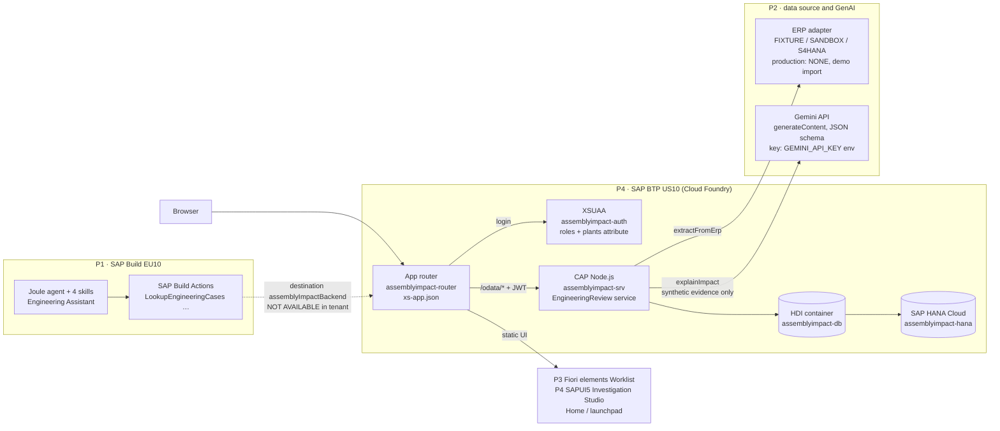
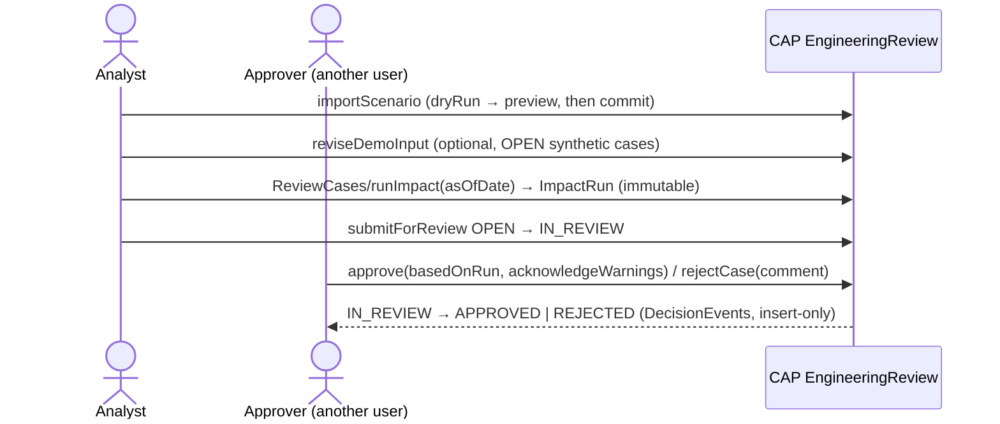

# AssemblyImpact AI

Engineering change impact for manufactured assemblies: an analyst compares two BOM revisions of an assembly, the
application calculates material shortages, cost delta and affected work instructions with a deterministic CAP ruleset,
and an independent approver approves or rejects the change. One integrated scenario covers the four examination
projects (P1 Joule, P2 S/4HANA + GenAI, P3 AI-assisted Fiori, P4 Fiori on BTP).

All business data is **synthetic** (fictional company NovaMotion Manufacturing). No record comes from a real SAP
S/4HANA system.

> **Status as of 2026-11-10 (evening):**
> - **Deployed:** `main@0c9c961` (PRs #20–#24) on SAP BTP US10 (Cloud Foundry, SAP HANA Cloud HDI, XSUAA, app router), deployed by the owner with `cf deploy`. HANA records were preserved: 7 cases, 1 impact run, COOL-100 still +1,200.00 EUR with 2 materials short.
> - **Gemini:** `GEMINI_API_KEY` is set on `assemblyimpact-srv` by the owner. The live call failed with HTTP 404, because `gemini-2.5-flash` is not available to new projects.
> - **Open:** PR #25 (switch to `gemini-3.5-flash-lite`, plus two UI fixes) is not yet merged or deployed. Section 17 has the evidence table.

## Contents

1. [What is implemented](#1-what-is-implemented)
2. [P1–P4 mapping](#2-p1p4-mapping)
3. [Architecture](#3-architecture)
4. [Business process and states](#4-business-process-and-states)
5. [Database](#5-database)
6. [Authentication: development vs. deployed](#6-authentication-development-vs-deployed)
7. [Run it locally (faculty demonstration)](#7-run-it-locally-faculty-demonstration)
8. [SAP BTP deployment](#8-sap-btp-deployment)
9. [HANA connectivity](#9-hana-connectivity)
10. [Joule (P1): EU10 and US10](#10-joule-p1-eu10-and-us10)
11. [UI walkthrough](#11-ui-walkthrough)
12. [Business rules](#12-business-rules)
13. [Tests and evidence](#13-tests-and-evidence)
14. [Known limitations and next actions](#14-known-limitations-and-next-actions)
15. [GenAI assistance disclosure](#15-genai-assistance-disclosure)
16. [P1–P4 in detail and professor demonstration](#16-p1p4-in-detail-and-professor-demonstration)
17. [Evidence table](#17-evidence-table)

## 1. What is implemented

| Capability | Where |
|---|---|
| Assembly catalog (plant-scoped, ETag updates) | `srv/assembly-service.*` |
| Engineering review service: BOM revisions, prices, stock, work instructions, review cases | `srv/engineering-review.*`, `db/engineering.cds` |
| Deterministic impact calculation `runImpact(asOfDate)`: BOM comparison, stock gaps, exact-decimal cost, instruction checks; immutable run snapshots | `srv/lib/impact-calculator.js`, `srv/lib/impact-persistence.js` |
| Review workflow: submit, approve, reject, evidence acknowledgement, separation of duties, decision history | `srv/lib/review-decisions.js` |
| Synthetic scenario import (validated preview, all-or-nothing commit) and controlled edit of synthetic inputs | `srv/lib/scenario-import.js`, `srv/lib/demo-data.js` |
| Consumption planning (PR #21): per-day stock projection from DAY/WEEK/MONTH rates, separate from the impact result | `srv/lib/coverage.js`, `srv/lib/planning.js` |
| S/4HANA-shaped ERP adapter (P2; fixture mode) and grounded, structured GenAI explanation (P2). Providers: Google Gemini API (backend only, PR #23), SAP Generative AI Hub, labelled fixture | `srv/integration/`, `docs/p2/genai-provider.md` |
| Fiori elements worklist (P3), SAPUI5 Investigation Studio (P4), landing page | `app/case-worklist`, `app/investigation-studio`, `app/home`, `app/launchpad.html` |
| SAP Build Actions contract for Joule (P1) | `test/p1-actions-contract.test.js`, EU10 Actions projects (section 10) |
| MTA for Cloud Foundry: CAP srv, HDI deployer, app router, XSUAA, destination | `mta.yaml`, `xs-security.json`, `app/router/xs-app.json` |

## 2. P1–P4 mapping

| Project | Implemented | Status | External blocker |
|---|---|---|---|
| **P1 Joule Skills & Agent** | Two released SAP Build Actions projects in the shared EU10 trial (`AssemblyImpact Engineering Actions` 1.0.0, `AssemblyImpact Engineering Read Actions` 1.0.1) over the EngineeringReview OData service; Joule Studio classic project `AssemblyImpact Engineering Assistant` with four skills (`Engineering Case Lookup`, `Explain Case Impact`, `Review Decision History`, `Run Engineering Impact` with a confirmation step) and the agent `Engineering Assistant`: all saved and validated (Design Console 0), not released. Actions contract tested locally. **Joule runtime test in the private environment:** Joule selected the skill/agent and extracted `caseNumber = EC-000473` | Skill and agent selection runtime-tested; **the backend call cannot complete** | EU10: no destination to the CAP service (needs subaccount trust and destination administration in the shared tenant); US10: no Joule Studio-capable SAP Build plan (section 10, `p1/joule/EU10-STATUS-2026-11-10.md`) |
| **P2 S/4HANA + GenAI** | ERP adapter with `fixtures` / `sandbox` / `s4` modes. Grounded explanation (`explainImpact`) with the Gemini provider (`gemini-3.5-flash-lite`, JSON schema, per-section validation); only synthetic data is sent | Deployed `main@0c9c961`; Gemini API key configured. First live call returned HTTP 404. PR #25 has been merged with the model and error-handling fixes, but the updated version is not yet verified in production. Sandbox and S/4 modes are not live-tested | Deploy the latest merged version and verify a successful Gemini response. No authorized live S/4HANA system is available. |
| **P3 AI-assisted Fiori** | Case Worklist (Fiori elements V4) generated first with SAP Project Accelerator, then reviewed and adapted | Implemented; evidence `docs/evidence/p3-case-worklist/` | — |
| **P4 Fiori on BTP** | Investigation Studio (SAPUI5) + CAP + HANA + XSUAA + app router on BTP | Deployed (`main@0c9c961`), checked in the browser (section 17) | — |

The Fiori UIs (P3, P4) use the shared CAP backend and deterministic business rules. P1 Joule is designed to call the same backend once authorized EU10 connectivity is configured. No project duplicates the impact calculation.

## 3. Architecture



Execution path of one engineering change:
1. **Import.** The analyst imports a synthetic scenario. The CAP service validates it and writes HANA.
2. **Calculate.** `runImpact` calculates deterministically and stores an immutable run.
3. **Explain.** `explainImpact` sends that run's facts to Gemini and validates the answer section by section. Nothing is stored.
4. **Review.** The analyst calls `submitForReview`, and a different user with the Approver role calls `approve` or `rejectCase`. The decision is stored insert-only.
5. **Joule (P1).** Joule would read the same CAP endpoints through SAP Build Actions; the destination is missing.

- The UI5 runtime is loaded from the SAPUI5 CDN (`sapui5.hana.ondemand.com`, 1.149).
- The app router serves the UI from `resources/` (staged by `tools/btp/stage-ui.mjs` during the MTA build) and forwards `/odata/*` to the CAP service (destination `srv-api`, `forwardAuthToken`).
- The CAP service in production serves **only** OData. Opening `launchpad.html` on the srv route returns 404 — always use the router URL (section 8).

## 4. Business process and states



States: `OPEN` → `IN_REVIEW` → `APPROVED` / `REJECTED`. The server refuses self-decision
(`SELF_DECISION_NOT_ALLOWED`), stale or missing evidence and unacknowledged warnings. The UI shows why an action is not
offered (`runImpactHint`, `submitHint`, `decideHint`), but every check is on the server.

## 5. Database

Model: `db/engineering.cds` (namespace `assemblyimpact`), `db/schema.cds`.

| Entity | Purpose | Key rules |
|---|---|---|
| `Assemblies` | assembly (material) per plant | unique `assemblyCode` + `plant` |
| `BOMStates`, `BOMItems` | BOM revisions and lines | revision + validity per assembly; quantity > 0 |
| `CostPrices`, `StockSnapshots` | prices with validity, stock snapshots | price ≥ 0; stock ≥ 0 |
| `Instructions`, `InstructionReferences` | work instructions and the materials they reference | |
| `ReviewCases` | engineering change under review | **unique `caseNumber`** (database constraint) |
| `ImpactRuns`, `ImpactComparisonLines`, `ImpactMaterialLines`, `Findings` | immutable calculation snapshots | written only by `runImpact` |
| `DecisionEvents` | insert-only review history | |
| `DataImports`, `CaseAttachments` | import/edit audit, evidence images | |
| `MaterialConsumptionRates` (PR #21) | planning input, immutable, withdrawn via `deactivate(reason)` | no overlap of active periods |

Every exposed entity carries a plant restriction (`plant = $user.plants`). Identifiers: internal UUIDs are never shown
as business keys; the case number (EC-nnnnnn), assembly ID, revision ID and BOM state key are defined in
`docs/business-rules/identifiers-quantities-and-planning.md`.

## 6. Authentication: development vs. deployed

| | Local development (BAS / `cds watch`) | Deployed (Cloud Foundry) |
|---|---|---|
| Mechanism | CAP **mocked** auth: HTTP Basic, users in `package.json` → `cds.requires.[development].auth.users` | XSUAA OAuth (`[production]` profile), SAP ID users |
| Users | `analyst` (ChangeAnalyst, DemoDataImporter), `approver` (ChangeApprover), `cviewer` (ChangeViewer), `analyst2000` (plant 2000), password `development-only` — public demo values, not secrets | real users with role collections `AssemblyImpact_Analyst` / `_Approver` / `_Viewer` (roles with static attribute `plants = 1000`) |
| Role decision | server (mock user definition) | server (JWT scopes + `plants` attribute) |
| Switch user | `/dev-users.html` (PR #21, development only) | sign out and sign in as another SAP ID user, or use a second browser profile |

Two layers exist in BAS: the BAS preview gateway (`portNNNN-workspaces-...`) first requires the **BAS/SAP ID session**
of the workspace owner; a fresh incognito window has no such session and receives 401 from the gateway before the
application is reached. Behind it, CAP asks for the **mock user** (Basic auth). Browsers cache one Basic login per
origin, so the launchpad's *Sign Out* cannot switch mock users. `/dev-users.html` replaces the cached login by sending
the chosen user's credentials once; the server validates them and the Home page shows *Signed in as ...* from
`whoAmI()`.

`dev-users.html` is not staged into the app router and production CAP does not serve `app/`
(`test/planning-and-hints.test.js` checks the staging script and `xs-app.json`).

Two-person demo locally: browser profile 1 → `/dev-users.html` → *Analyst*; browser profile 2 (signed in to BAS too)
→ `/dev-users.html` → *Approver*. Both use the same server process and the same data.
Two-person demo deployed: two SAP ID users, one with `AssemblyImpact_Analyst`, one with `AssemblyImpact_Approver`.

## 7. Run it locally (faculty demonstration)

```bash
git clone https://github.com/Naman028/assemblyimpact-ai.git && cd assemblyimpact-ai
npm ci
npm test            # 187 tests, in-memory SQLite, isolated port
npm run lint
cds watch --port 4005    # BAS: cds-dk is installed globally; elsewhere: npx -p @sap/cds-dk cds watch
```

Open the BAS preview of the port (`https://portNNNN-<workspace>.../dev-users.html`), choose a user, then the launchpad.

Data source: development uses **in-memory SQLite** seeded from `test/data` (7 plant-1000 cases, a plant-2000 mirror).
Every process has its own database: `npm start` on one port and `npm run dev` / `cds watch` on another show different
case states, and a restart (also an automatic `cds watch` restart after a source change) returns to the seed. This is
not HANA. `npm run demo` uses a file database `db/demo.sqlite` (`npm run demo:init` first).

Demo (10 steps): Create Scenario → search assembly → accept proposed case number → enter BOM (0 = not in that
revision) → validate and import → Run Impact → inspect Assembly/BOM/Materials/Cost tabs → Consumption Planning →
Submit for Review (analyst) → Approve/Reject (approver in the second browser profile).

## 8. SAP BTP deployment

- Subaccount `78485bd6trial`, region US10, CF org `78485bd6trial`, space `dev`.
- Apps: `assemblyimpact-router` (started), `assemblyimpact-srv` (started), `assemblyimpact-db-deployer` (stopped after deploying — expected).
- **Use only:** `https://78485bd6trial-dev-assemblyimpact-router.cfapps.us10-001.hana.ondemand.com/launchpad.html`
- Build: `mbt build -t mta_archives` (runs `npm ci`, `cds build --production`, `tools/btp/stage-ui.mjs`); deploy: `cf deploy mta_archives/<file>.mtar` (never with `--delete-services`).
- srv memory: 256 MB on `main` ran at 251 MB on HANA; PR #20 raises it to 512 MB.
- Application deployment (`cf deploy`) and database migration (the HDI deployer applying `.hdbtable` changes) happen in one MTA deployment, but they are different things: the app can be redeployed without schema change; a schema change is only additive when the generated delta is (checked in `docs/btp/PR21-deployment-assessment.md`).
- Access, roles and HANA inventory: PR #20, `docs/btp/ACCESS-AND-DATABASE-GUIDE.md`.

The reported launchpad 404 was reproduced on the **srv** route and on mistyped paths; the router route answers
correctly (section 2 of `docs/btp/PR21-deployment-assessment.md`).

## 9. HANA connectivity

| Environment | Database | Verified by |
|---|---|---|
| BAS local (`cds watch`, `npm start`, tests) | in-memory SQLite | `cds watch` log: `connect to db > sqlite { url: ':memory:' }` |
| BAS hybrid (`--profile hybrid`) | would use HANA through `cds bind` | profile exists in `package.json`; **no binding was created** (not needed, and it would connect a dev session to business data) |
| Deployed CAP | HDI container `assemblyimpact-db` on `assemblyimpact-hana` | srv log `connect to db > hana` (container schema), record counts unchanged across deployment and restart (`docs/btp/deployment-2026-11-10.md`) |

Changing source in BAS does not change HANA: only an MTA deployment runs the HDI deployer.

## 10. Joule (P1): EU10 and US10

| Check | Result (2026-11-10) |
|---|---|
| EU10 Actions projects | `AssemblyImpact Engineering Actions` latest 1.0.0, `AssemblyImpact Engineering Read Actions` latest 1.0.1 — both listed as available (released) |
| EU10 Joule Studio classic | project `AssemblyImpact Engineering Assistant` with four Joule skills (*Engineering Case Lookup*, *Explain Case Impact*, *Review Decision History*, *Run Engineering Impact* with Send Confirmation Request) and the agent *Engineering Assistant* using all four. Everything is saved and validated (Design Console 0) and not released. Per-skill configuration and types: `p1/joule/EU10-STATUS-2026-11-10.md` |
| EU10 Control Tower → Environments | a **private environment** is active (activated on 2026-11-10), alongside the public one |
| EU10 Test (private environment) | test package deployed. Joule answered "Look up engineering case EC-000473" by **selecting the skill** and passing `caseNumber = EC-000473` to the API call (`docs/evidence/p1-eu10-2026-11-10/03-*.jpg`, `04-*.jpg`). The call cannot complete: the variable `assemblyImpactBackend` has no destination to this backend, and other users' destinations were not used |
| Runtime readiness EU10 | needs a destination from the tenant to the CAP service with OAuth; the shared trial tenant gives no destination administration → not executable |
| US10 | SAP Build Lobby without Joule Studio; entitlements show SAP Build Process Automation `free`/`standard`, no `build_default` plan with Joule → import of a Joule Studio project not possible |
| Export / transport | Joule Studio classic supports project export/import between tenants; not performed, because no eligible target tenant exists |
| Notice | Joule Studio classic shows that its generative AI features are deprecated from January 2027 |

Next useful P1 action: an enterprise or university SAP Build tenant with Joule (build_default + IAS + Joule
entitlement) and destination rights. Nothing in the application fakes a Joule connection; the Home page shows
*P1 Joule assistant: Not connected*.

## 11. UI walkthrough

- **Home** (`#AssemblyImpact-overview`): counts, data provenance, integration status, signed-in user.
- **Engineering Change Worklist** (P3, Fiori elements): filter cases, object page with impact run, findings and *Review Actions* (why an action is unavailable).
- **Investigation Studio** (P4): case list; header KPIs; tabs Assembly (component diagram, highlight resets on case change), BOM Comparison, Materials, Cost, Consumption Planning, AI Explanation, Work Instructions, Findings, Evidence, Review.
- **Create Scenario**: assembly search, server-proposed case number, revision IDs, component table, validated preview.
- **Review**: approver banner "Ready for your decision", Approve/Reject with comment.

## 12. Business rules

- Impact calculation (data contract, invariants, COOL-100 oracle +1,200.00 EUR / 2 materials short): `docs/m04/M04_Data_Contract.md`.
- Identifiers, quantity and price semantics, consumption calculation, date boundaries, missing data, approval constraints: `docs/business-rules/identifiers-quantities-and-planning.md`.
- In short: quantity 0 in revision B removes a component (no zero line is stored); a positive quantity re-adds it; price 0 is a valid price, a missing price makes cost INCOMPLETE; days without a consumption rate are unknown demand (INCOMPLETE), never confirmed zero.

## 13. Tests and evidence

- `npm test`: 196/196 on PR #23 (unit, service/API, authorization, business rules, concurrency, Gemini provider with stubbed HTTP); 187/187 on PR #24. CI results are recorded on the PRs.
- Deployed `main@0c9c961` checked in a browser on 2026-11-10, read-only:
  - `systemStatus`: dataSourceMode NONE, databaseKind HANA, authMode PRODUCTION.
  - `whoAmI` plants "1000" (deduplicated).
  - Counts: 7 cases, 1 run. COOL-100: COMPLETE_WITH_WARNINGS, +1200.00 EUR, 2 short, 1 work-instruction finding, 0 decisions.
  - `searchAssemblies('COOL')` → COOL-100; `nextCaseNumber` → EC-000487.
  - `materialCoverage` returns INCOMPLETE (no consumption rates stored), as designed.
  - Worklist at 390 px shows 7 pop-in rows.
  - Studio tabs (Assembly, BOM Comparison, Materials, Consumption Planning, AI Explanation) and Create Scenario search were checked; the dialog was cancelled, nothing was saved.
  - The worklist object page shows Approve/Reject disabled for the analyst.
  - Screenshots: `docs/evidence/deployed-0c9c961/`.
  - The one live Gemini call returned HTTP 404 (see P2). It was not repeated, to save quota.
- Earlier browser check (`main@22158b7`):
  - XSUAA sign-in works (authMode PRODUCTION).
  - `systemStatus`: data source NONE, GenAI NOT_CONFIGURED, Joule NOT_CONNECTED.
  - 7 cases, all plant 1000, and no case from another plant is visible.
  - A missing case returns 404.
  - `explainImpact` returns 409 `GENAI_NOT_CONFIGURED`.
  - `/dev-users.html` returns 404.
  - Defects found: plants shown as "1000, 1000, 1000" (fixed in PR #22), and the worklist showing only the image column at 390 px (fixed in PR #24, see `docs/evidence/worklist-narrow-screen/`).
- AI Explanation tab (PR #23) checked in BAS: `docs/evidence/p2-gemini-ui/`.
- CI: `.github/workflows/ci.yml` (lint, tests, audit) on every PR.
- Browser walkthrough of PR #21 in BAS (separate clone, port 4005, in-memory SQLite): `docs/evidence/pr21-bas-walkthrough/` (20 screenshots; defects found there were fixed on the branch).
- Earlier evidence: `docs/evidence/faculty-demo/`, `docs/evidence/p3-case-worklist/`, `docs/evidence/rc1-browser-check/`.

## 14. Known limitations and next actions

Blockers:
- **P1 Joule:** no destination from the EU10 tenant to the CAP service. Creating one needs trust and destination administration in the shared subaccount. Skill selection works at runtime; the backend call does not.
- **P2 Gemini:** PR #25 must be merged and deployed. After that, one live call decides whether the key and model work. Serving EEA users needs a paid (billing-enabled) Google project.
- **P2 S/4HANA:** no authorized live system; all data is labelled synthetic.

Open:
- Merge and deploy PR #25.
- Assign the Approver role to a second SAP ID user to show the review decision on the deployed app. The analyst view, with Approve/Reject disabled, is verified.
- Cross-plant isolation on BTP needs a second identity in another plant; automated tests cover it.
- The router answers 404 for `launchpad.html?x=1` (query string before the hash). Use the URL without a query string.

## 15. GenAI assistance disclosure

- **AI-assisted development:** large parts of the source, tests and documentation were generated by AI assistants
  (OpenAI Codex for M03; Anthropic Claude for M04 onwards, including PR #21) and reviewed, tested and committed by the
  student team. Commit messages and PR descriptions identify generated work.
- **AI-supported testing and documentation:** test cases and this README were drafted with Claude and checked against
  the running application, CI and BTP.
- **SAP AI in the application:** P3 used SAP Project Accelerator (evidence folder). Joule is designed but not running
  (section 10). The GenAI explanation uses the Google Gemini API from the CAP backend (deployed; the first live call failed with HTTP 404 because of the model choice, fixed in PR #25) or a labelled fixture. No LLM calculates, authorizes or decides anything.
  Claude is not part of the deployed application.

## 16. P1–P4 in detail and professor demonstration

**P1: SAP Joule.**
- **Design:** `p1/joule/skills.json` defines four skills (find cases, explain impact, decision history, run impact with confirmation) and an agent that never decides. The skills use the operations in `p1/build-actions/*.openapi.json` against the CAP service. `test/p1-actions-contract.test.js` checks every response against that spec, including 403/404 and plant restriction.
- **In the EU10 tenant:**
  - Actions projects 1.0.0 and 1.0.1 are released.
  - All four skills and the agent *Engineering Assistant* are saved and validated (Design Console 0). In the private environment, Joule selected the skill and the agent with the right input; no backend call completed.
  - Execution against the backend is **blocked** by the missing destination.
  - The impact, materials, work-instruction and history skills are design-time only (`skills.json` and contract tests); they were not built in Joule Studio, because they cannot be tested without the destination.
  - Status: `p1/joule/EU10-STATUS-2026-11-10.md`.

**P2: ERP data source, HANA persistence, Gemini.**
- **ERP source:**
  - `srv/integration/erp/erp-source.js` defines the modes FIXTURE, SANDBOX and S4HANA. Production runs `NONE`, using validated demo import (`srv/lib/scenario-import.js`).
  - The active mode and data provenance appear on Home and on every case.
  - All data is written to HANA through the HDI container (section 9).
- **Gemini** (`srv/integration/genai/impact-explanation.js`):
  - backend-only `generateContent` call with a JSON response schema
  - per-section grounding checks
  - only synthetic cases are sent
  - the key comes from the `GEMINI_API_KEY` environment variable
  - details in `docs/p2/genai-provider.md`

**P3: SAPUI5 application architecture.**
- **Case Worklist** (`app/case-worklist`): Fiori elements V4 List Report and Object Page, driven by `annotations.cds`. It was first generated with SAP Project Accelerator (`docs/evidence/p3-case-worklist/`) and is responsive (`UI.Importance`).
- **Investigation Studio** (`app/investigation-studio`): freestyle SAPUI5 with an MVC structure — `view/*.view.xml`, `controller/Workspace.controller.js` and the formatters in `lib/format.js`. It uses the OData V4 model with bound actions.
- **Home** (`app/home`): system status and provenance.

**P4: Cloud Foundry, XSUAA, HDI.**
- **`mta.yaml`** defines four modules: srv, the HDI deployer, the router, and the services XSUAA (`xs-security.json`, role templates with a `plants` attribute) and destination.
- **Routing and roles:**
  - The app router (`app/router/xs-app.json`) authenticates through XSUAA and forwards the JWT.
  - CAP checks roles and `plants` on every entity and action (`srv/engineering-review.cds` `@restrict`).
- **Deployment:** `mbt build` then `cf deploy`, never with `--delete-services`. HDI deploys additive schema changes only (`docs/btp/`).

**Professor demonstration (deployed, about 10 minutes):**
1. Open `https://78485bd6trial-dev-assemblyimpact-router.cfapps.us10-001.hana.ondemand.com/launchpad.html` and sign in with the SAP ID user. Home shows the data source, HANA, the AI status and the signed-in role.
2. Open the **Engineering Change Worklist**. Filter, then open EC-000473 (COOL-100). The object page shows the impact, findings and history, with Approve/Reject disabled for an analyst.
3. Open the **Investigation Studio**, then EC-000473, and go through these tabs:
   - Assembly
   - BOM Comparison (FAN-A→FAN-B, BRKT-01 2→3, SEAL-01 added)
   - Materials (BRKT-01 short 50, FAN-B short 20)
   - Cost (+1,200.00 EUR)
   - Consumption Planning
4. **AI Explanation:** *Generate explanation*. This makes one live Gemini call, once PR #25 is deployed. Show the deterministic panel and the AI sections side by side.
5. **Create Scenario:** search an assembly and show the proposed case number, then *Validate and Preview*. Commit only if a new demo case is wanted.
6. **Narrow the browser** to phone width: the worklist keeps the case number and status visible.
7. **Review workflow:** *Submit for Review* as analyst; Approve or Reject as a second SAP ID user with `AssemblyImpact_Approver`.
8. **P1:** show the Joule Studio test screenshots (`docs/evidence/p1-eu10-2026-11-10/`) and explain the destination blocker.

Locally without BTP: section 7.

## 17. Evidence table

| Requirement | Status | Evidence |
|---|---|---|
| CAP + HANA (HDI) + XSUAA + app router on BTP | Completed and deployed | `main@0c9c961` deploy log (owner, 2026-11-10); `systemStatus` databaseKind HANA; counts preserved |
| Impact calculation, COOL-100 oracle | Completed and deployed | +1200.00 EUR, 2 short on HANA; `test/impact-calculator.test.js` |
| Worklist (P3) incl. phone width | Completed and deployed | `docs/evidence/deployed-0c9c961/07-*`, 390 px pop-in check |
| Investigation Studio tabs, Create Scenario search, Consumption Planning | Completed and deployed (read-only check) | `docs/evidence/deployed-0c9c961/01-06` |
| Permission-aware review controls | Completed and deployed (analyst view) | Approve/Reject disabled on the object page; server `@restrict` tests |
| Review decision by a second user on BTP | Still incomplete (needs an Approver user) | covered by `test/m05-review-workflow.test.js` |
| ERP source modes and provenance | Completed and deployed (mode NONE + demo import) | `systemStatus`, Home |
| Gemini explanation | Deployed with key; live call failed (HTTP 404, model); fix in PR #25 | `cf logs` (2026-11-10 19:19 UTC); `test/p2-gemini-provider.test.js` |
| Home AI status / 5xx message | Locally tested (PR #25) | `test/ui-landing-startup.test.js`, `test/p2-genai-explanation.test.js` |
| P1 Actions | Completed (released 1.0.0 / 1.0.1) | EU10 Actions projects |
| P1 skill Engineering Case Lookup | Runtime-tested up to the API call (skill selection, input extraction) | `docs/evidence/p1-eu10-2026-11-10/03-04` |
| P1 backend execution, release, deployment | Blocked by external permission (destination in EU10); administrator handoff written | `p1/joule/EU10-STATUS-2026-11-10.md` |
| P1 further skills and agent | Saved and validated in Joule Studio (Design Console 0); agent selection runtime-tested; not released | `docs/evidence/p1-eu10-2026-11-10/05-10`, `p1/joule/EU10-STATUS-2026-11-10.md` |
| S/4HANA live extraction | Blocked (no authorized system) | `docs/p2/S4HANA_Adapter.md` |

