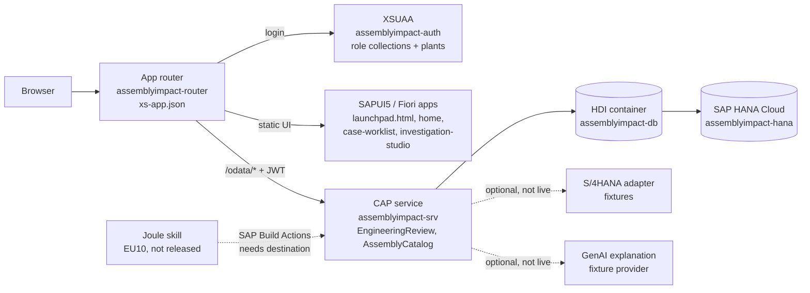
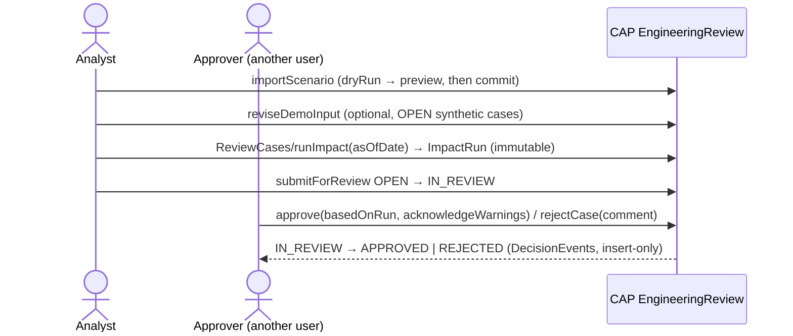

# AssemblyImpact AI

Engineering change impact for manufactured assemblies: an analyst compares two BOM revisions of an assembly, the
application calculates material shortages, cost delta and affected work instructions with a deterministic CAP ruleset,
and an independent approver approves or rejects the change. One integrated scenario covers the four examination
projects (P1 Joule, P2 S/4HANA + GenAI, P3 AI-assisted Fiori, P4 Fiori on BTP).

All business data is **synthetic** (fictional company NovaMotion Manufacturing). No record comes from a real SAP
S/4HANA system.

> Status as of 2026-11-10. `main@ca75e77` is deployed to the SAP BTP US10 trial (Cloud Foundry, HANA Cloud, XSUAA).
> PR #20 (deployment handover guide) and PR #21 (defect fixes, consumption planning, demo sign-in) are open and
> **not merged or deployed**. Facts below say which state they describe.

## Contents

1. [What is implemented](#1-what-is-implemented)
2. [P1–P4 mapping](#2-p1p4-mapping)
3. [Architecture](#3-architecture)
4. [Business process and states](#4-business-process-and-states)
5. [Database](#5-database)
6. [Authentication: development vs. deployed](#6-authentication-development-vs-deployed)
7. [Run it locally (faculty demonstration)](#7-run-it-locally-faculty-demonstration)
8. [SAP BTP deployment](#8-sap-btp-deployment)
9. [HANA connectivity](#9-hana-connectivity)
10. [Joule (P1): EU10 and US10](#10-joule-p1-eu10-and-us10)
11. [UI walkthrough](#11-ui-walkthrough)
12. [Business rules](#12-business-rules)
13. [Tests and evidence](#13-tests-and-evidence)
14. [Known limitations and next actions](#14-known-limitations-and-next-actions)
15. [GenAI assistance disclosure](#15-genai-assistance-disclosure)

## 1. What is implemented

| Capability | Where |
|---|---|
| Assembly catalog (plant-scoped, ETag updates) | `srv/assembly-service.*` |
| Engineering review service: BOM revisions, prices, stock, work instructions, review cases | `srv/engineering-review.*`, `db/engineering.cds` |
| Deterministic impact calculation `runImpact(asOfDate)`: BOM comparison, stock gaps, exact-decimal cost, instruction checks; immutable run snapshots | `srv/lib/impact-calculator.js`, `srv/lib/impact-persistence.js` |
| Review workflow: submit, approve, reject, evidence acknowledgement, separation of duties, decision history | `srv/lib/review-decisions.js` |
| Synthetic scenario import (validated preview, all-or-nothing commit) and controlled edit of synthetic inputs | `srv/lib/scenario-import.js`, `srv/lib/demo-data.js` |
| Consumption planning (PR #21): per-day stock projection from DAY/WEEK/MONTH rates, separate from the impact result | `srv/lib/coverage.js`, `srv/lib/planning.js` |
| S/4HANA-shaped ERP adapter (P2; fixture mode) and grounded GenAI explanation (P2; fixture provider) | `srv/integration/` |
| Fiori elements worklist (P3), SAPUI5 Investigation Studio (P4), landing page | `app/case-worklist`, `app/investigation-studio`, `app/home`, `app/launchpad.html` |
| SAP Build Actions contract for Joule (P1) | `test/p1-actions-contract.test.js`, EU10 Actions projects (section 10) |
| MTA for Cloud Foundry: CAP srv, HDI deployer, app router, XSUAA, destination | `mta.yaml`, `xs-security.json`, `app/router/xs-app.json` |

## 2. P1–P4 mapping

| Project | Implemented | Status | External blocker |
|---|---|---|---|
| **P1 Joule Skills & Agent** | Two released SAP Build Actions projects in the shared EU10 trial (`AssemblyImpact Engineering Actions` 1.0.0, `AssemblyImpact Engineering Read Actions` 1.0.1) over the EngineeringReview OData service; Joule Studio classic project `AssemblyImpact Engineering Assistant` with the skill `Engineering Case Lookup` (not released); Actions contract tested locally | Partially implemented, **no live Joule execution** | EU10: shared trial tenant without destination administration; US10: no Joule Studio-capable SAP Build plan (section 10) |
| **P2 S/4HANA + GenAI** | ERP adapter with `fixtures` / `sandbox` / `s4` modes and grounded explanation (`explainImpact`) | Implemented and tested with fixtures; sandbox, S/4 and SAP AI Core modes not run live | No authorized S/4HANA system or AI Core binding |
| **P3 AI-assisted Fiori** | Case Worklist (Fiori elements V4) generated first with SAP Project Accelerator, then reviewed and adapted | Implemented; evidence `docs/evidence/p3-case-worklist/` | — |
| **P4 Fiori on BTP** | Investigation Studio (SAPUI5) + CAP + HANA + XSUAA + app router on BTP | Deployed (`main@ca75e77`); PR #21 fixes not deployed | Approval for PR #21 deployment |

All four share one backend: Joule (P1) and the UIs (P3, P4) call the same CAP actions and business rules; no
project duplicates the calculation.

## 3. Architecture



- The UI5 runtime is loaded from the SAPUI5 CDN (`sapui5.hana.ondemand.com`, 1.149).
- The app router serves the UI from `resources/` (staged by `tools/btp/stage-ui.mjs` during the MTA build) and forwards `/odata/*` to the CAP service (destination `srv-api`, `forwardAuthToken`).
- The CAP service in production serves **only** OData. Opening `launchpad.html` on the srv route returns 404 — always use the router URL (section 8).

## 4. Business process and states



States: `OPEN` → `IN_REVIEW` → `APPROVED` / `REJECTED`. The server refuses self-decision
(`SELF_DECISION_NOT_ALLOWED`), stale or missing evidence and unacknowledged warnings. The UI shows why an action is not
offered (`runImpactHint`, `submitHint`, `decideHint`), but every check is on the server.

## 5. Database

Model: `db/engineering.cds` (namespace `assemblyimpact`), `db/schema.cds`.

| Entity | Purpose | Key rules |
|---|---|---|
| `Assemblies` | assembly (material) per plant | unique `assemblyCode` + `plant` |
| `BOMStates`, `BOMItems` | BOM revisions and lines | revision + validity per assembly; quantity > 0 |
| `CostPrices`, `StockSnapshots` | prices with validity, stock snapshots | price ≥ 0; stock ≥ 0 |
| `Instructions`, `InstructionReferences` | work instructions and the materials they reference | |
| `ReviewCases` | engineering change under review | **unique `caseNumber`** (database constraint) |
| `ImpactRuns`, `ImpactComparisonLines`, `ImpactMaterialLines`, `Findings` | immutable calculation snapshots | written only by `runImpact` |
| `DecisionEvents` | insert-only review history | |
| `DataImports`, `CaseAttachments` | import/edit audit, evidence images | |
| `MaterialConsumptionRates` (PR #21) | planning input, immutable, withdrawn via `deactivate(reason)` | no overlap of active periods |

Every exposed entity carries a plant restriction (`plant = $user.plants`). Identifiers: internal UUIDs are never shown
as business keys; the case number (EC-nnnnnn), assembly ID, revision ID and BOM state key are defined in
`docs/business-rules/identifiers-quantities-and-planning.md`.

## 6. Authentication: development vs. deployed

| | Local development (BAS / `cds watch`) | Deployed (Cloud Foundry) |
|---|---|---|
| Mechanism | CAP **mocked** auth: HTTP Basic, users in `package.json` → `cds.requires.[development].auth.users` | XSUAA OAuth (`[production]` profile), SAP ID users |
| Users | `analyst` (ChangeAnalyst, DemoDataImporter), `approver` (ChangeApprover), `cviewer` (ChangeViewer), `analyst2000` (plant 2000), password `development-only` — public demo values, not secrets | real users with role collections `AssemblyImpact_Analyst` / `_Approver` / `_Viewer` (roles with static attribute `plants = 1000`) |
| Role decision | server (mock user definition) | server (JWT scopes + `plants` attribute) |
| Switch user | `/dev-users.html` (PR #21, development only) | sign out and sign in as another SAP ID user, or use a second browser profile |

Two layers exist in BAS: the BAS preview gateway (`portNNNN-workspaces-...`) first requires the **BAS/SAP ID session**
of the workspace owner; a fresh incognito window has no such session and receives 401 from the gateway before the
application is reached. Behind it, CAP asks for the **mock user** (Basic auth). Browsers cache one Basic login per
origin, so the launchpad's *Sign Out* cannot switch mock users. `/dev-users.html` replaces the cached login by sending
the chosen user's credentials once; the server validates them and the Home page shows *Signed in as ...* from
`whoAmI()`.

`dev-users.html` is not staged into the app router and production CAP does not serve `app/`
(`test/planning-and-hints.test.js` checks the staging script and `xs-app.json`).

Two-person demo locally: browser profile 1 → `/dev-users.html` → *Analyst*; browser profile 2 (signed in to BAS too)
→ `/dev-users.html` → *Approver*. Both use the same server process and the same data.
Two-person demo deployed: two SAP ID users, one with `AssemblyImpact_Analyst`, one with `AssemblyImpact_Approver`.

## 7. Run it locally (faculty demonstration)

```bash
git clone https://github.com/Naman028/assemblyimpact-ai.git && cd assemblyimpact-ai
npm ci
npm test            # 185 tests, in-memory SQLite, isolated port
npm run lint
cds watch --port 4005    # BAS: cds-dk is installed globally; elsewhere: npx -p @sap/cds-dk cds watch
```

Open the BAS preview of the port (`https://portNNNN-<workspace>.../dev-users.html`), choose a user, then the launchpad.

Data source: development uses **in-memory SQLite** seeded from `test/data` (7 plant-1000 cases, a plant-2000 mirror).
Every process has its own database: `npm start` on one port and `npm run dev` / `cds watch` on another show different
case states, and a restart (also an automatic `cds watch` restart after a source change) returns to the seed. This is
not HANA. `npm run demo` uses a file database `db/demo.sqlite` (`npm run demo:init` first).

Demo (10 steps): Create Scenario → search assembly → accept proposed case number → enter BOM (0 = not in that
revision) → validate and import → Run Impact → inspect Assembly/BOM/Materials/Cost tabs → Consumption Planning →
Submit for Review (analyst) → Approve/Reject (approver in the second browser profile).

## 8. SAP BTP deployment

- Subaccount `78485bd6trial`, region US10, CF org `78485bd6trial`, space `dev`.
- Apps: `assemblyimpact-router` (started), `assemblyimpact-srv` (started), `assemblyimpact-db-deployer` (stopped after deploying — expected).
- **Use only:** `https://78485bd6trial-dev-assemblyimpact-router.cfapps.us10-001.hana.ondemand.com/launchpad.html`
- Build: `mbt build -t mta_archives` (runs `npm ci`, `cds build --production`, `tools/btp/stage-ui.mjs`); deploy: `cf deploy mta_archives/<file>.mtar` (never with `--delete-services`).
- srv memory: 256 MB on `main` ran at 251 MB on HANA; PR #20 raises it to 512 MB.
- Application deployment (`cf deploy`) and database migration (the HDI deployer applying `.hdbtable` changes) happen in one MTA deployment, but they are different things: the app can be redeployed without schema change; a schema change is only additive when the generated delta is (checked in `docs/btp/PR21-deployment-assessment.md`).
- Access, roles and HANA inventory: PR #20, `docs/btp/ACCESS-AND-DATABASE-GUIDE.md`.

The reported launchpad 404 was reproduced on the **srv** route and on mistyped paths; the router route answers
correctly (section 2 of `docs/btp/PR21-deployment-assessment.md`).

## 9. HANA connectivity

| Environment | Database | Verified by |
|---|---|---|
| BAS local (`cds watch`, `npm start`, tests) | in-memory SQLite | `cds watch` log: `connect to db > sqlite { url: ':memory:' }` |
| BAS hybrid (`--profile hybrid`) | would use HANA through `cds bind` | profile exists in `package.json`; **no binding was created** (not needed, and it would connect a dev session to business data) |
| Deployed CAP | HDI container `assemblyimpact-db` on `assemblyimpact-hana` | `mta.yaml` bindings; PR #20 persistence check across a restart (7 cases, 1 run, 7 findings) |

Changing source in BAS does not change HANA: only an MTA deployment runs the HDI deployer.

## 10. Joule (P1): EU10 and US10

| Check | Result (2026-11-10) |
|---|---|
| EU10 Actions projects | `AssemblyImpact Engineering Actions` latest 1.0.0, `AssemblyImpact Engineering Read Actions` latest 1.0.1 — both listed as available (released) |
| EU10 Joule Studio classic | project `AssemblyImpact Engineering Assistant`, one Joule skill `Engineering Case Lookup` (uses action `FindEngineeringCases`), shown as modified and not released; no agent |
| Runtime readiness EU10 | needs a destination from the tenant to the CAP service with OAuth; the shared trial tenant gives no destination administration → not executable |
| US10 | SAP Build Lobby without Joule Studio; entitlements show SAP Build Process Automation `free`/`standard`, no `build_default` plan with Joule → import of a Joule Studio project not possible |
| Export / transport | Joule Studio classic supports project export/import between tenants; not performed, because no eligible target tenant exists |
| Notice | Joule Studio classic shows that its generative AI features are deprecated from January 2027 |

Next useful P1 action: an enterprise or university SAP Build tenant with Joule (build_default + IAS + Joule
entitlement) and destination rights. Nothing in the application fakes a Joule connection; the Home page shows
*P1 Joule assistant: Not connected*.

## 11. UI walkthrough

- **Home** (`#AssemblyImpact-overview`): counts, data provenance, integration status, signed-in user.
- **Engineering Change Worklist** (P3, Fiori elements): filter cases, object page with impact run, findings and *Review Actions* (why an action is unavailable).
- **Investigation Studio** (P4): case list; header KPIs; tabs Assembly (component diagram, highlight resets on case change), BOM Comparison, Materials, Cost, Consumption Planning, AI Explanation, Work Instructions, Findings, Evidence, Review.
- **Create Scenario**: assembly search, server-proposed case number, revision IDs, component table, validated preview.
- **Review**: approver banner "Ready for your decision", Approve/Reject with comment.

## 12. Business rules

- Impact calculation (data contract, invariants, COOL-100 oracle +1,200.00 EUR / 2 materials short): `docs/m04/M04_Data_Contract.md`.
- Identifiers, quantity and price semantics, consumption calculation, date boundaries, missing data, approval constraints: `docs/business-rules/identifiers-quantities-and-planning.md`.
- In short: quantity 0 in revision B removes a component (no zero line is stored); a positive quantity re-adds it; price 0 is a valid price, a missing price makes cost INCOMPLETE; days without a consumption rate are unknown demand (INCOMPLETE), never confirmed zero.

## 13. Tests and evidence

- `npm test`: 185 tests (unit, service/API, authorization, business rules, concurrency) — 185/185 locally on PR #21; CI results are recorded on the PR.
- CI: `.github/workflows/ci.yml` (lint, tests, audit) on every PR.
- Browser walkthrough of PR #21 in BAS (separate clone, port 4005, in-memory SQLite): `docs/evidence/pr21-bas-walkthrough/` (20 screenshots; defects found there were fixed on the branch).
- Earlier evidence: `docs/evidence/faculty-demo/`, `docs/evidence/p3-case-worklist/`, `docs/evidence/rc1-browser-check/`.

## 14. Known limitations and next actions

Blockers: live Joule (P1) needs a licensed tenant; live S/4HANA and SAP AI Core (P2) need authorized systems.
Open: approve, merge and deploy PR #20/#21; create a second SAP ID user with the Approver role for the deployed demo;
narrow-screen layout of the Studio not re-verified in a resized browser after PR #21.

## 15. GenAI assistance disclosure

- **AI-assisted development:** large parts of the source, tests and documentation were generated by AI assistants
  (OpenAI Codex for M03; Anthropic Claude for M04 onwards, including PR #21) and reviewed, tested and committed by the
  student team. Commit messages and PR descriptions identify generated work.
- **AI-supported testing and documentation:** test cases and this README were drafted with Claude and checked against
  the running application, CI and BTP.
- **SAP AI in the application:** P3 used SAP Project Accelerator (evidence folder). Joule is designed but not running
  (section 10). The GenAI explanation uses a fixture provider; no LLM calculates, authorizes or decides anything.
  Claude is not part of the deployed application.
